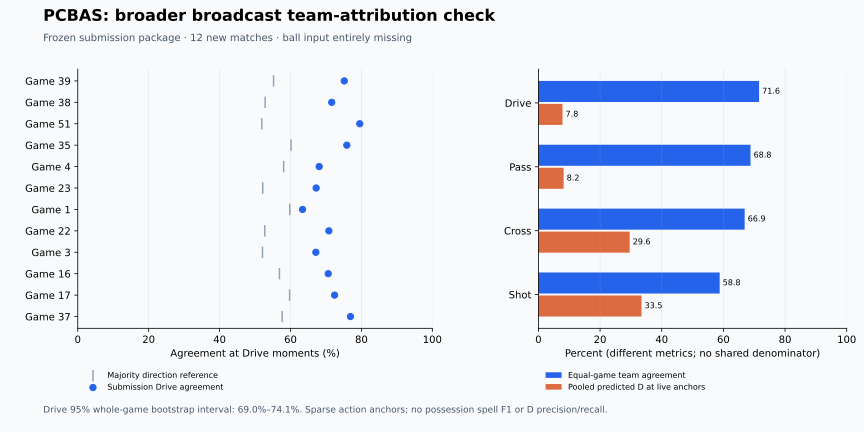

# Expanded PCBAS match evaluation

Study `pcbas_expanded_anchor_v2`, completed 2 November 2026. All 24 halves and
96 class/half cells independently verify. The adopted package is retained.
No model changes or fitting. Runner source commit: `8fe3d37`.

## Question and evidence scope

Does the exact adopted submission package reliably identify the acting team at
live action moments across additional matches from the new SoccerNet/FOOTPASS source?
This extends the [three-game VAL diagnostic](PCBAS_CONFIDENCE_V1.md), whose
results are already exposed. It tests the same player-only input regime across
more matches and estimates uncertainty across games. It does not supply
continuous possession labels or official possession spell F1.

The newly approved source is
[SoccerNet/SN-PCBAS-2026](https://huggingface.co/datasets/SoccerNet/SN-PCBAS-2026).
Its TRAIN archive contains 48 matches from a 2023–24 European cohort. TRAIN is
the publisher's action-recognition partition; none of these inputs is used to
fit, calibrate, select or normalize the possession package in this study.
Anonymized game IDs prevent exhaustive fixture-level deduplication. Results
must therefore remain external event-anchor evidence, rather than certified
independent full-pipeline gold confirmation.

## Fixed protocol

Rank complete TRAIN game IDs by SHA-256 of
`pcbas_expanded_anchor_v2:<game_id>`; take the first twelve, both native halves.
Exclude the three previously scored VAL IDs. The remaining 36 games stay in
reserve and receive no predictions or model scores. The cohort is selected
without reading event targets, class balance, visibility or predictions.

The frozen game order is 39, 38, 51, 35, 4, 23, 1, 22, 3, 16, 17 and 37.
The [declaration](results/pcbas_expanded_anchor_v2_declaration.json) binds all
24 halves, their target-free feature hashes, 30 source files and all four
checkpoint hashes. The [acquisition receipt](results/pcbas_expanded_anchor_v2_acquisition.json)
verifies the archive, 8,801,202,512-byte HDF5 and official event file.

Use the unchanged
`joint_gru_sn_dense_original_diversity_phase_ensemble_v1` package: both sealed
seed/teacher pairs, five-phase averaging and its frozen decoder. Input reads
exclude the HDF5 action-class column. The event JSON, actor and target team do
not enter inference. Ball input is entirely missing, as this source has no ball
entity. Preserve finite-ROI player visibility, native timestamps and half
boundaries. The inherited 105×68 m coordinate standardization remains an
assumption; there is no scale, offset, decoder or threshold search.

First replay 750 frames through the direct deployed API and study wrapper and
require exact decoded equality. Verify input, source, manifest and checkpoint
hashes; then predict each complete selected half. Seal all predictions before
the one-use event-scoring gate is claimed and labels are joined. An interrupted
run may resume only from matching complete per-half artifacts and receipts.

Drive is primary. Pass, Cross and Shot are separate secondary diagnostics.
Replay events, ambiguous same-frame opposing-team events, exact duplicates and
anchors without exact tracking frames are excluded using the frozen rules
from the first diagnostic. D/X at a live anchor counts as incorrect. Neither
background events nor unannotated frames constitute dead-ball ground truth.

Sum halves within each match, then weight matches equally. Also report pooled
counts, per-game direction balance and the descriptive majority-direction-alias
reference. These aliases are half-local attacking directions, not persistent
home/away teams. The reference uses target frequencies and is not a deployable
trained comparator. Primary uncertainty uses 10,000 paired whole-game bootstrap
draws, fixed seed `20261102`, for Drive accuracy and its difference from that
reference. Halves, frames and action anchors are never independent resampling
units. Intervals describe match variation in this source, not unseen-provider
uncertainty or qualification probability.

Prespecified visibility diagnostics use 0–5, 6–11 and 12+ visible players at the
anchor frame. They pool the four reported action classes and are descriptive;
their class mix can differ. Source-imputed off-screen positions remain masked.
Predicted D frequency at live anchors measures a false dead-play pattern, not
D precision/recall or overall live/dead accuracy.

## Source and reproduction

The tactical archive is pinned to revision
`a16e373c8c8d26b1af4874f4208810baf337e709`, expected 2,457,804,618 bytes and
SHA-256 `160ecf571b5eb8298b231dcb003973702dc413469216d13d849e2c7ef6fe44ee`.
Official TRAIN events are pinned to FOOTPASS commit
`f63f37c1a0c6bcebf568a8ce716495a459376af5`,
`playbyplay_GT/playbyplay_train.json`. Access-controlled raw data and native
outputs remain under ignored `data/`; aggregate evidence contains no raw tracks
or reconstructive predictions. No raw-data upload is part of this work.

Install the [PCBAS dependency file](requirements-pcbas.txt), then run from the
repository root:

```sh
.venv/bin/python -m unittest experiments.tests.test_pcbas_expanded_anchor_v2 -v
.venv/bin/python -m experiments.pcbas_expanded_anchor_v2 freeze
.venv/bin/python -m experiments.pcbas_expanded_anchor_v2 parity
# For each of the 24 keys in the frozen declaration:
.venv/bin/python -m experiments.pcbas_expanded_anchor_v2 predict --half GAME_H1
.venv/bin/python -m experiments.pcbas_expanded_anchor_v2 seal
.venv/bin/python -m experiments.pcbas_expanded_anchor_v2 score
.venv/bin/python scripts/verify_pcbas_expanded_anchor_v2.py
```

Completed declarations, predictions, seals and score gates are immutable. Do
not recreate them to obtain another result. The independent verifier recomputes
counts, exclusions, visibility strata and bootstrap intervals from the sealed
arrays without repeating inference or reopening a score gate.

## Completed results

The fixed package processed **1,800,471 native frames** across 24 full halves.
Only sparse event moments are graded; this is not twenty hours of dense gold
possession evaluation. All 23,039 source events independently join to the
tracking frame, direction, shirt and action class. The score includes **19,152
eligible anchors**: 1,916 unselected-class events and 1,971 selected-class
replay events are excluded. There are no duplicate, opposing-team-collision or
unmatched-frame exclusions in this sample. The 36 reserved games are unscored.

| Action | Correct / anchors | Pooled agreement | Equal-game agreement | Pooled predicted D at live anchors |
| --- | ---: | ---: | ---: | ---: |
| Drive, primary | 5,819 / 8,071 | 72.10% | **71.57%** | 631 / 8,071 = 7.82% |
| Pass | 7,114 / 10,303 | 69.05% | 68.80% | 843 / 10,303 = 8.18% |
| Cross | 333 / 500 | 66.60% | 66.89% | 148 / 500 = 29.60% |
| Shot | 167 / 278 | 60.07% | 58.79% | 93 / 278 = 33.45% |

The primary 95% whole-game bootstrap interval is **68.95–74.10%**. Drive
agreement ranges from 63.40% to 79.54% across games. Every game exceeds its
descriptive majority-direction reference; the equal-game difference is
**+15.80 percentage points**, paired 95% interval **+12.47 to +18.99 points**.
The reference itself averages 55.77%. These intervals assume game-level
exchangeability within this one source; anonymized fixtures and repeated teams
limit broader independence claims.

The earlier VAL result, 71.66% across three different games, is consistent with
this larger result. This is corroboration of a diagnostic, not a measured model
improvement. Do not subtract these different-cohort means or pool the fifteen
games into an untouched confirmation headline. No checkpoint or decoder changed.



The fixed visibility breakdown pools all four action classes:

| Visible players | Anchors | Correct agreement | Predicted D at live anchors |
| --- | ---: | ---: | ---: |
| 0–5 | 144 | 47 / 144 = 32.64% | 48 / 144 = 33.33% |
| 6–11 | 4,205 | 2,439 / 4,205 = 58.00% | 559 / 4,205 = 13.29% |
| 12+ | 14,803 | 10,947 / 14,803 = 73.95% | 1,108 / 14,803 = 7.48% |

Performance is weaker in the low-visibility strata, but this is observational:
the class, game and camera-condition mixtures differ. Only 144 anchors have
0–5 visible players. Do not infer a causal visibility effect or use this table
to choose filtering thresholds. The repeat cross/shot dead-play pattern remains
material even with more games; the current study does not isolate its cause.

## Verification and delivery

All **609 experiment tests**, **26 root tests**, the synthetic file-backed fit
contract and bundled 199,319-row CSV format check pass. A real 750-frame parity
control matches the exact deployed API before inference. All source, input and
four checkpoint hashes verify. The independent verifier reproduces all 96
class/half cells, 23,039 source-event joins, exclusions, visibility summaries,
per-game/pooled counts and bootstrap intervals. No inference or organizer scoring
was repeated for verification. The aggregate chart was visually checked.

The [result](results/pcbas_expanded_anchor_v2_result.json) and
[independent verification](results/pcbas_expanded_anchor_v2_verification.json)
retain full precision. The declaration, score gate and prediction seal stay
closed. Raw tracking, events and native outputs are locally verified under
ignored data; no raw-data upload or independent remote restore is claimed.
Existing deployment artifact availability is unchanged.

Code and aggregate evidence are published in
[PR #78](https://github.com/jekkiechan/more-than-a-hack-2027/pull/78).

The [research progress site](https://more-than-a-hack-progress.tanapat-ratana.chatgpt.site/)
is published as **version 27** after the user's explicit 2 November approval.
The expanded experiment, per-game interactive chart, Overview/model timeline,
Data, Metrics and Method updates are live. All 12 desktop/mobile page checks,
16 chart-control combinations, aggregate parity and local links pass, with no
JavaScript errors. Restricted audience revision 2 and the same two external
viewers are verified unchanged.

The initial missing-helper blocker is resolved through native scoped Git source
access, local static packaging, and native Sites save/deploy. Source commit
`585e1ab3fe574888fd95ec1ed4a2c1ae36abd44a` is remotely verified and deployment
succeeded. The [publication receipt](results/pcbas_expanded_anchor_v2_publication.json)
records the saved version, deployment and verification. No raw data, weights or
native predictions are uploaded as part of this site update.

## Decision and remaining gap

Keep the submission package unchanged. The larger sparse-anchor sample supports
useful player-only team attribution across more games, but cannot
answer continuous possession segmentation, boundary accuracy, short-spell
recovery, or official spell F1. The more representative input source still
lacks measured ball input and continuous H/A/D/X targets.

The next stronger possession evaluation requires independently annotated
continuous broadcast intervals on separate matches, using video-only blind
annotation with last-controlled-team semantics, preserved unknown regions and
uncertain boundaries. Freeze labels and the model comparison before scoring
with the official evaluator; keep at least one whole match untouched by model
selection. Do not interpolate PCBAS action points into possession gold.
