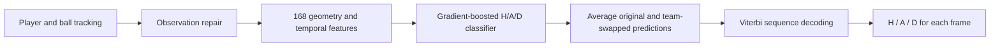

# Possession pipeline takeover

This work starts from `60b89dd` on the fork's `main`. Claude's latest branch,
`ccr-400015d3-yz5xkl` (`b5d0b1b`), contributed the multi-source validation results
merged in PR #7. The earlier LightGBM comparison and research plan are also
already on `main`. The new work is on `possession/robust-pipeline`.

The immediate research question is whether the existing data can support better
possession attribution through observation repair, control context, ensembling
and decoding. Adding another provider remains useful, but is not a prerequisite
for this bounded experiment.

## Results

The declared objective selects **preprocessing plus control context**, with the
full model's D probabilities and team/dead costs **3/3**. Across providers and
clean/degraded conditions, spell F1 rises from **0.5259 to 0.5512** (+0.0253),
while macro F1 moves from **0.8113 to 0.8147**. This is a validation result, not
independent confirmation or competition performance.

All eight candidates, ordered by the declared objective:

| Candidate | Mean spell F1 | Mean macro F1 |
| --- | ---: | ---: |
| **Control context (selected)** | **0.5512** | 0.8147 |
| Team ensemble + half player-only D, costs 3/8 | 0.5455 | **0.8398** |
| Team ensemble + half player-only D, costs 3/3 | 0.5448 | 0.8390 |
| Team ensemble, full-model D | 0.5446 | 0.8141 |
| Baseline with identical training settings | 0.5259 | 0.8113 |
| Preprocessing only | 0.5251 | 0.8105 |
| Team ensemble + player-only D, costs 3/8 | 0.5075 | 0.8123 |
| Team ensemble + player-only D, costs 3/3 | 0.5033 | 0.8110 |

Here each provider is excluded from training when evaluated. SkillCorner cells
below average its three validation matches; the other providers have one each.

| Provider | Baseline clean spell | Context clean spell | Baseline degraded spell | Context degraded spell |
| --- | ---: | ---: | ---: | ---: |
| Sportec | 0.6062 | 0.6248 | 0.5003 | 0.5044 |
| Metrica | 0.6708 | 0.7401 | 0.5780 | 0.6250 |
| SkillCorner | 0.4045 | 0.4056 | 0.3959 | 0.4075 |

The strongest gain is Metrica H/A attribution. Preprocessing alone helps degraded
Sportec but does not improve the aggregate. The fixed team ensemble improves on
the baseline, but dilutes the stronger contextual model on Metrica.

Dead-ball transfer remains unresolved. On clean SkillCorner, the selected model's
D F1 is **0.3637**, against **0.6341** for the half-player-D ensemble with 3/8
costs. That blend also raises SkillCorner macro F1 from **0.6150 to 0.7216** and
spell F1 from **0.4056 to 0.4256**. It loses on the full-view sources, however.
Its overall spell gap to the selected model is only **0.0058**, with no seed
repeats or new-match confirmation; this does not establish a reliable ranking.

The next useful bounded comparison is to combine the contextual H/A expert with
the D head independently of the weaker baseline team expert, and to test
observation-quality-dependent D blending on external sources. Challenge-specific
ball fusion and tracking-confidence features need the organizer assets. These
are follow-ups, not unreported additional candidates in this run.

The complete **80 aggregate score rows**, predeclared settings, code/data hashes
and selection are in [results/pipeline_validation.json](results/pipeline_validation.json).
Validation took 1,492 seconds with three feature workers and two fitting threads.
The selected settings are refitted on all 13 training matches; the five validation
matches remain excluded from that fit. The earlier competition candidate is not
overwritten or submitted by this experiment.

## Public five-minute pipeline check

On 2026-10-25, the organizer's tactical tracking text and metadata were restored
from the participant's authorized data share. Regenerating all four reference
baselines reproduced the bundled CSVs byte for byte, confirming the inputs and
frame alignment. The externally selected `context` configuration, model and
feature code remained frozen. Its full 199,319-row CSV passed the official
validator before the public labels were scored once with the official CLI.

| Model | Public spell F1 | Public macro F1 | Frame accuracy |
| --- | ---: | ---: | ---: |
| **New contextual model** | **0.4190** | **0.6455** | **72.08%** |
| Previous selected refinement (earlier check) | 0.4300 | 0.6487 | 74.92% |
| Earlier PathCRF + robust-D hybrid (earlier check) | 0.5067 | 0.6795 | 77.47% |

Only the new contextual model was scored in this check; the comparison rows are
previously recorded results, not new trials. The external validation gain has
not produced an improvement on this public segment. With only 7,500 graded
frames and 17 true possessions, the new model's 1,000-resample conditional 90%
bootstrap intervals are wide: **[0.2952, 0.5333]** for spell F1 and
**[0.4792, 0.7772]** for macro F1. They do not establish a full-match ranking.

Class F1 is **H 0.8034 / A 0.7387 / D 0.3945**. Dead-ball recall is **0.2907**,
and the output contains **25 predicted possessions versus 17 reference
possessions** in the graded window. The model still misses many stoppages and
produces too many possession intervals on this segment. These are aggregate
pipeline diagnostics, not a basis for adjusting thresholds on the public labels.
No model, feature, blend, decoder setting or selection was changed after this
check, and no organizer submission was made.

The aggregate report and model/input/prediction/scorer hashes are in
[results/pipeline_competition.json](results/pipeline_competition.json). Raw
tracking, the generated `competition.csv`, its provenance sidecar and detailed
reports remain under ignored `data/`. The check used an exclusive
`data/experiments/pipeline_v1/public_check/` directory and recorded its start
before loading the public labels. The scorer command was:

```sh
python evaluation/run_evaluation.py --gt public \
  --results data/experiments/pipeline_v1 \
  --out data/experiments/pipeline_v1/public_check --bootstrap 1000
```

Read the recorded result for ongoing work; do not turn public scoring into an
iteration loop. Future model choices must continue to use external validation.

## Implemented changes

`possession_pipeline.py` keeps all inference behind the existing tracking-field
allowlist. Historical models and feature definitions are unchanged.

The selected inference path is:



The classifier has 120 boosting rounds and at most 31 leaves per tree. It returns
three probabilities per frame: home possession, away possession and dead ball.
The original and H/A-swapped views use the same fitted classifier; probabilities
are mapped back to the original team names before averaging. The final decoder
maximizes the sequence's summed log probabilities with a fixed penalty for label
changes (3 in 10-Hz units, scaled by frame rate). It resets at period/time breaks,
does not force a minimum possession length, and writes X outside playing halves.

The 137 existing features describe proximity, ball/player motion and local
context. The 31 additions describe sustained control evidence, its age before
and after the current frame, support around the ball and repair quality. Recent
control evidence expires after five seconds. Future tracking context is available
because submission inference is offline; no future possession labels are inputs.

The separate player-only D model and baseline/context blend are retained as
experimental alternatives. Their blend weights are zero in the selected
configuration: the selected prediction uses the contextual classifier's own D
probability. The wider inference harness currently also computes those unused
alternatives, but they do not affect the selected output.

- **Preprocessing:** respect observation flags, normalize incomplete XY pairs,
  reject isolated impossible position spikes, and interpolate internal player
  gaps of at most 0.2 seconds when the endpoints imply at most 13 m/s. Ball-spike
  rejection uses a generous 65 m/s bound. It requires both adjacent jumps to be
  implausible and the bridge between neighbours to be plausible; persistent
  displacements are not silently rewritten. There is no long-gap extrapolation.
- **Features:** add unambiguous proximity evidence, its continuous duration,
  recent and upcoming control evidence with a five-second expiry, agreement
  across an observation gap, team support fractions, and repair indicators.
  New control features use speed-checked ball interpolation up to 0.5 seconds.
  The historical physical feature block retains its original 0.5-second ball
  interpolation, without a speed gate. Every temporal operation resets at a
  half, clock reset or timestamp gap. Centred/future context is legitimate for
  this offline task.
- **Augmentation:** give every ablation the same clean and degraded copies,
  each with H/A swap. Degradation adds the existing 41% generated ball mask,
  8% per-player missingness with 0.6-second mean gaps, and same-team slot
  switches. These rates describe synthetic masks, not final missing fractions
  or a calibrated simulation of the challenge camera.
- **Ensemble:** combine the baseline and contextual model's *conditional H/A
  probabilities* 50/50, separately from D. A confident D prediction therefore
  cannot suppress an expert's team vote. Compare full-model D, a 50/50 blend
  with player-only D, and player-only D.
- **Postprocessing:** use the existing exact Viterbi decoder, comparing 3/3
  team/dead transition costs with 3/8 for the D blends. No forced minimum
  possession duration or manual boundary correction is introduced.

The fixed physical thresholds are experimental choices, not thresholds fitted
to organizer labels. They need external evidence, just like the model changes.

## Validation protocol

`pipeline_eval.py` declares its complete protocol and data/code hashes before
feature extraction or fitting. A changed dataset, dependency, protocol or source
file invalidates resume. Feature caches and completed match evaluations can be
resumed only under the matching manifest. Partial or duplicate score matrices
cannot select a model.

Use the whole-match assignments in `dead_transfer.SPLITS`:

| Provider | Training pool | Validation |
| --- | --- | --- |
| Sportec | J03WMX, J03WN1, J03WOH | J03WOY |
| Metrica | Games 1, 2 | Game 3 |
| SkillCorner | First eight fixed IDs | 1996435, 1996436, 2006229 |

There are **three leave-one-provider-out folds**. Each trains on the training
pool of the other two providers and evaluates the excluded provider's validation
matches. Validation matches are never training examples in any fold. Selection
averages official spell F1 equally across providers, then equally across their
matches and clean/degraded conditions; macro F1 breaks ties. Three SkillCorner
matches do not receive triple the weight of one Sportec match.

Eight candidates isolate preprocessing, added context, ensembling, D-head
mixing and the decoder cost. All use the same bounded HGB capacity: 31 leaves,
120 iterations, learning rate .08, seed 17, approximately 2 Hz training samples,
native-rate feature computation/evaluation, and training-only short-spell weights
with beta .5. Weight is normalized first per match and then per provider. The
player-only D head uses equal match/provider weighting without live-spell weights.
This is a controlled comparison at a smaller capacity than the previous
63-leaf/260-iteration suite; scores must not be compared as if capacity and
training protocol were unchanged.

The selected configuration is refitted on all **13 training matches**. The final
refit does not consume any of the five validation matches. Neither historical
Sportec tests J03WPY/J03WR9/J03WQQ nor organizer possession labels are opened.

Limitations: these validation matches have already supported earlier research;
this is not fresh independent confirmation. There is one fitting seed per run.
SkillCorner's silver-label timing uncertainty remains, and scoring still excludes
frames with fewer than 12 detected players, as in the earlier suite. Synthetic
degradation does not reproduce camera occlusion. The selected result cannot
establish full-match competition performance.

## Reproduction

Install `experiments/requirements.txt`. Restore the processed external arrays to
their existing paths under ignored `data/`, or use the public conversion commands
in [OPEN_DATA.md](OPEN_DATA.md). The private `jekkiechan/mtah-data` cache can be
cloned separately with Git LFS; keep it private and never add it as a remote of
the public code repository. Only the train/validation files listed above are
needed. An unresolved LFS pointer is rejected before a run starts.

```sh
python -m unittest discover -s experiments/tests -v
python -m experiments.pipeline_eval --feature-workers 3 --threads 2 --fit-final
```

Default outputs are in `data/experiments/pipeline_v1/`: the predeclared protocol,
feature caches, three fold models, complete validation results, selected settings,
and the final model with checksums. The run may take tens of minutes on a CPU.
Use the identical command to resume. Use a new `--out` directory after changing
code, data or seed. Preserve earlier runs rather than overwriting their protocol.

Once the organizer's tactical tracking metadata/text files are present under
`data/tactical/` (or `MTAH_DATA_DIR`):

```sh
python -m experiments.pipeline_predict
python evaluation/validate_submission.py data/experiments/pipeline_v1/competition.csv
```

Alternatively pass `--inputs data/challenge/inputs.npz` for an existing tracking
export. The loader deserializes only allowed tracking fields, even if the NPZ
contains target fields. Model/source checksums are verified before inference.
The output command masks frames outside the playing halves, validates all
199,319 rows, writes a provenance sidecar and refuses to overwrite a submission.
It does not score public labels or submit anything to the organizers.

Organizer assets were not present at takeover. The tactical tracking text and
metadata have now been restored for the frozen public check. Broadcast tracking,
videos, homography and Smart Tagging were not used by this model. Dual-feed ball
fusion, homography confidence and Smart Tagging integration remain separate
follow-up experiments; no results for those are claimed here.
