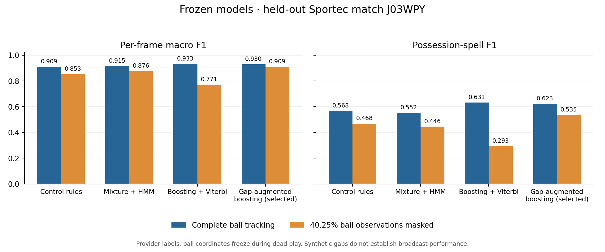

# Possession experiments

**Ensembling:** [GRU plus boosting](TEMPORAL_ENSEMBLE.md) raises external
provider-holdout D spell F1 from .5649 (GRU) / .5652 (ordered HGB) to .5746
(50/50 GRU + HGB). Three-way GRU/HGB/LightGBM reaches .5750, a negligible
additional margin. No new organizer check or competition-selection change.

**New temporal comparison:** [ordered features, TCN, and bidirectional GRU](LEARNED_TEMPORAL.md)
with fixed H/A attribution. On historical provider-holdout D development folds,
ordered HGB scores 0.5652 spell F1 versus 0.5588 for the matched HGB baseline;
BiGRU scores 0.5649 and TCN 0.5605. The TCN improves D F1 more than spell F1.
This is a modest external development gain. The subsequent
[organizer five-minute check](TEMPORAL_PUBLIC_CHECK.md) gives BiGRU .4889 spell
F1 and TCN .4541, versus the prior selected refinement's .4300 and prior
PathCRF hybrid's .5067. Externally selected ordered HGB scores .4205. Public
scores did not change the frozen external selection.
The [evaluation manifest and shortcut audit](eval_set/README.md) document
provenance, whole-match splits, silver labels, and the missing fresh test set.

**Latest:** [refinement and competition results](REFINEMENT.md). The final
external test improved to **0.9408 frame macro F1 / 0.7059 spell F1**. On the
competition's public five-minute pipeline check, the externally selected model
scored **0.6487 / 0.4300**; the predeclared PathCRF hybrid scored **0.6795 / 0.5067**.
The 0.90 target is not met on the competition data, and full-match accuracy is
unknown. The original experiment below is retained for provenance.

We reached **0.9298 frame macro F1** and **0.6232 possession-spell F1** on a
held-out Sportec match with the model selected before test access. With synthetic
ball-observation gaps, it scored **0.9090 / 0.5355**. These are external benchmark
results, not demonstrated accuracy on the hackathon match.

Sportec freezes ball coordinates during dead play. That makes dead-ball detection
unusually easy, even though explicit possession/status fields never enter model
features. Read [the source audit](BENCHMARK_AUDIT.md) before interpreting the score.
Away-team F1 is 0.8673; reaching 0.90 macro F1 does not mean every class reaches it.

## Data and evaluation

- Primary: [Sportec Open DFL, Bassek et al., version 1](https://doi.org/10.6084/m9.figshare.28196177.v1),
  CC BY 4.0, provider H/A/D labels. Downloads verify published sizes and checksums.
- Fixed whole-match split: train J03WMX/J03WN1/J03WOH, validation J03WOY,
  test J03WPY. Düsseldorf appears in each partition; this is a new match, not an
  unseen team or provider. No random-frame splitting.
- Auxiliary: [SkillCorner open data](https://github.com/SkillCorner/opendata), MIT,
  five separately partitioned matches. Its H/A labels are algorithmic and null
  labels remain X. It does not establish three-class H/A/D accuracy. See
  [DATASETS.md](DATASETS.md).
- Metrics: unchanged competition evaluator, with explicit breaks between halves
  and time discontinuities. Frame macro F1 averages H/A/D F1. Spell F1 matches
  H/A intervals at temporal IoU 0.3, 0.4, 0.5, 0.6 and 0.7, then averages F1.
- Selection: highest validation spell F1 among models with frame macro F1 at
  least 0.90; otherwise highest frame macro F1. All four methods and the selected
  model were frozen and hashed before test access. Stress results did not select
  parameters. No challenge ground truth was used for training or model selection.

## Held-out results

One test match, J03WPY: 146,211 graded frames at 25 Hz, 421 reference possessions.
The masked condition hides 40.25% of ball coordinates in label-independent random
blocks, expected rate 41%, mean gap one second, seed 2026. All methods receive the
same mask; player coordinates remain available. Real camera occlusions are more
structured, so this is a sensitivity test rather than a broadcast benchmark.

| Method | Clean frame macro F1 | Clean spell F1 | Masked frame macro F1 | Masked spell F1 |
| --- | ---: | ---: | ---: | ---: |
| Nearest team | 0.3662 | 0.0895 | 0.2892 | 0.1253 |
| Nearest team + geometric dead-ball cue | 0.8462 | 0.1147 | 0.6155 | 0.1285 |
| [Confirmed-control state machine](STATE_MACHINE.md) | 0.9095 | 0.5679 | 0.8528 | 0.4681 |
| [Gaussian mixtures + HMM](TEMPORAL.md) | 0.9151 | 0.5523 | 0.8764 | 0.4463 |
| [Gradient boosting + Viterbi](SUPERVISED.md) | 0.9325 | 0.6311 | 0.7708 | 0.2934 |
| **[Gap-augmented boosting + Viterbi](ROBUST.md), preselected** | **0.9298** | **0.6232** | **0.9090** | **0.5355** |

The clean-trained model's slightly higher test score does not change our
validation-based selection. Differences this small on one match are not strong
evidence of superiority. The selected model's validation scores were 0.9188 frame
macro F1 and 0.6108 spell F1. A separate dead/alive then H/A boosting variant was
also tested on validation and did not improve the selection objective.



For the selected model on the clean test:

- Accuracy 94.54%; H/A/D F1 **0.9233 / 0.8673 / 0.9989**.
- Correct team label on reference live frames: 90.23%.
- Estimated home possession **63.83%**, reference **62.84%**: 0.99 percentage
  points error, each calculated as H/(H+A).
- Predicted 319 possession spells versus 421 reference spells. At IoU 0.5,
  229 match, 192 reference spells are missed, and 90 predictions are unmatched.
- Official 1,000-draw bootstrap, 5th–95th percentiles: macro F1
  **[0.9183, 0.9394]**, spell F1 **[0.5838, 0.6616]**. These intervals are
  conditional on this match, not uncertainty across leagues or tracking providers.

The best observed spell F1 is about 0.63 in these experiments. This is not an
estimated ceiling. Accurate long possessions can dominate frame scores while
short turnovers and interval boundaries still fail the spell metric.
The [post-hoc error analysis](ERROR_ANALYSIS.md) finds that possessions under
three seconds account for 68.2% of missed spells, despite occupying only 7.9% of
live time. No model parameters were changed after that analysis.

## Industry and open-source comparison

[The reference-method audit](REFERENCE_METHODS.md) distinguishes compatible
metrics from reported results. Borghesi et al. (2023) reported **86.2% possession
accuracy** and **89.2% dead/alive accuracy** for a temporal convolutional network
on confidential professional data. Those are accuracy figures, not possession
spell F1. We did not find a verified universal industry standard for this
competition's particular F1 definition.

PathCRF has public code and pretrained weights, but its supplied trial 140 was
trained on our primary validation and test matches. A separate evaluation must
use a match excluded from that checkpoint and remove the stock inference path's
use of true in-play episodes. Its published event F1 is also a different task.
The [separate pretrained-model comparison](PATHCRF.md) uses J03WR9. On that same
match, PathCRF plus a frozen geometric dead-ball rule scored **0.9382 macro F1 /
0.6015 spell F1**, versus **0.9320 / 0.6122** for our frozen model. Native PathCRF
H/A F1 on reference-live frames was **0.9148**. It is a competitive reusable model;
these small differences on one match do not establish a reliable winner.

## Reproduce

From the repository root, with Python 3.12:

```sh
python -m pip install -r experiments/requirements.txt
python experiments/audit_dataset.py

python experiments/state_machine.py tune --dead-ball \
  --split data/external_audit/sportec/split.json \
  --data data/external_audit/sportec/processed \
  --out data/experiments/state_machine/sportec
python experiments/state_machine.py tune --refine \
  --split data/external_audit/sportec/split.json \
  --data data/external_audit/sportec/processed \
  --out data/experiments/state_machine/sportec
python experiments/temporal.py --split data/external_audit/sportec/split.json \
  --out data/experiments/temporal_sportec
python experiments/supervised.py
python experiments/robust.py --baseline data/experiments/supervised/model.joblib

python -m unittest discover -s experiments/tests -v
python -m experiments.benchmark freeze
python -m experiments.benchmark test
python -m experiments.export_reports
```

Training uses CPU only. Roughly 1.9 GB of Sportec source data is downloaded for
the primary five matches. Raw data, processed arrays, model weights and frame
predictions remain under gitignored `data/`. The benchmark refuses to overwrite
an existing frozen manifest or restart a test evaluation. Use a fresh checkout
for a reproduction, not repeated test-driven tuning.

The tracked `results/primary_test.json` contains aggregate scores and
`results/primary_manifest.json` records the exact configuration and SHA-256 hashes.
The local runtime manifest is `data/experiments/benchmark/frozen_manifest.json`.
No model should be selected again using the reported test results.

## Challenge inference

After placing the organizer's data in the paths configured by `games.py`:

```sh
python -m experiments.benchmark challenge
```

This writes and validates the 199,319-row submission
`data/experiments/benchmark/challenge_robust.csv`, using the validation-selected
model. Frames outside the published halves are X. Inference reads no challenge
ground truth. The file is a transfer candidate; it has not established 0.90
accuracy on the hackathon's tracking distribution and was not submitted to the
competition. Organizer assets and per-frame predictions are not published.
