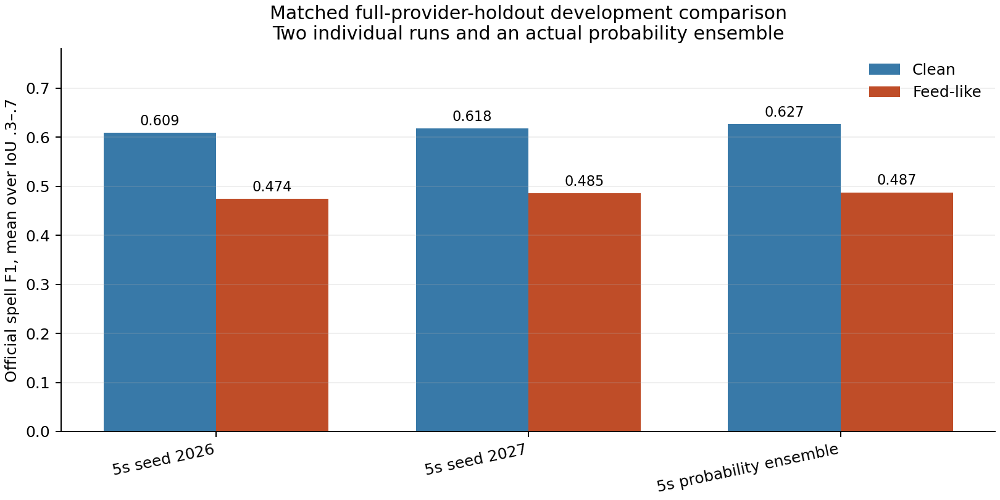
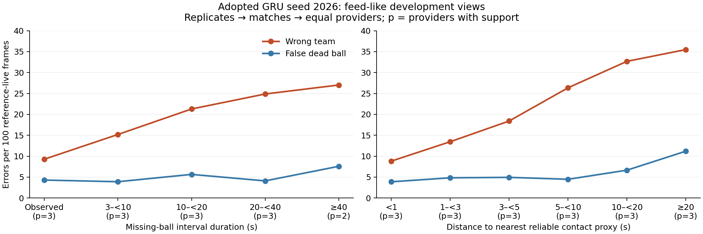

# Two-seed GRU ensemble and long-gap context

Status: running. Date: 2026-10-28. Branch:
`possession/seed-ensemble-gap-context`, based on `7615dd5`.

This study tests the adopted slot-dropout joint GRU on the same five previously
exposed external development matches. All learned H/A, D and normalization
components exclude the evaluation provider. It does not establish independent
broadcast or full organizer-match accuracy.

## Ensemble result and current gap diagnosis

The actual probability ensemble improves both headline views. Its extra gain
over seed 2027 is modest: +.0089 clean and +.0021 feed-like spell F1. Keep the
adopted single-seed package unchanged while the context experiment runs.



| Recipe / view | Spell F1 | Macro F1 | Auxiliary 70/30 | D precision | D recall |
| --- | ---: | ---: | ---: | ---: | ---: |
| Seed 2026 / clean | .608763 | .843432 | .679164 | .894689 | .786376 |
| Seed 2027 / clean | .617600 | .854336 | .688621 | .886197 | .827713 |
| Equal probability ensemble / clean | .626531 | .854559 | .694940 | .897016 | .814340 |
| Seed 2026 / feed-like | .474237 | .801255 | .572343 | .890351 | .785583 |
| Seed 2027 / feed-like | .485302 | .810874 | .582973 | .882069 | .823803 |
| Equal probability ensemble / feed-like | .487419 | .811127 | .584532 | .890409 | .810993 |

All 30 individual-seed parity cells reproduce the saved results. The ensemble
is 15 actual new decodes, not the mean of the two score rows. The ensemble
beats both seeds on Sportec and at the provider-averaged SkillCorner level,
but seed 2027 remains stronger on Metrica in both views. On feed-like live
frames, only seed 2026 is correct on 3.81%, only seed 2027 on 2.94%, and both
are wrong on 16.30%, using the same provider-balanced weighting. Complementary
errors exist, but most residual wrong frames are shared.

| Provider / view | Seed 2026 spell | Seed 2027 spell | Ensemble spell |
| --- | ---: | ---: | ---: |
| Sportec / clean | .61915 | .60335 | .64091 |
| Metrica / clean | .74785 | .78596 | .77220 |
| SkillCorner / clean | .45929 | .46350 | .46649 |
| Sportec / feed-like | .44286 | .43344 | .46263 |
| Metrica / feed-like | .55506 | .59647 | .57112 |
| SkillCorner / feed-like | .42479 | .42600 | .42850 |

The adopted seed's feed-like long-gap wrong-team rate is **24.32%**, versus
**5.10% false D**, compared with **9.28% wrong team on observed-ball rows**.
This satisfies the frozen condition for the longer-context fits. It supports
the H/A diagnosis on the synthetic feed-like views, with a material false-D
component still present.
Including reference-dead errors, the provider-balanced long-gap error partition
is 57.92% wrong team, 12.21% false D and 29.88% missed D. The diagnosis is a
majority H/A problem in this view, not an absence of dead-ball errors.

Native clean data does **not** support a broad long-live-gap claim: across all
five matches there are only **108 graded live frames** inside gaps >=10 s,
all from SkillCorner under the unchanged >=12-visible-player grading filter.
Their errors are 7 wrong-team and 81 false-D frames;
20 frames have the correct team. Sportec has no such gap rows; Metrica's long
native gaps cover dead play. This is a missing evaluation population, not
evidence that the baseline's real organizer-gap bottleneck is established.

On feed-like views, team accuracy declines from 87.31% within one second of a
reliable contact proxy to 69.17% at 5–<10 s and 53.31% at >=20 s. Short-spell
miss rates are about 92% in 10–<40 s gaps versus 73% on no-gap rows; direct
turnover recall within one second is about 4–6% versus 44%. Fragmentation is
about 2.6–2.9% in those gap bins versus 2.7% on no-gap rows. The diagnostic
points to misses and timing rather than a large rise in fragmentation.
SkillCorner has 784/1,125 reference spells touching graded-run edges (69.69%),
versus 1/456 Sportec and 4/382 Metrica. Short-spell counts therefore include
many censored observations; keep the official population, but avoid treating
all of these snippets as complete real possessions.



## Frozen comparison

[Declaration](results/seed_gap_context_declaration.json). All 253 files in the
archived `gru_slot_robustness_cache_manifest.json` were restored and verified
against the existing size/SHA-256 receipt before evaluation. No control was
retrained. Each of three held-out providers has the original seeds 2026/2027.

For each match/view, average the two **native H/A/D probability vectors equally**,
then run the unchanged Viterbi decoder at switch cost 3. Compare this inference
ensemble with each individual seed. Clean is native tracking; feed-like uses
the existing corruption realizations `corrupt_1`/`corrupt_2`, preserving ball
gaps, coordinates, player-slot gaps and ID swaps. Every individual clean and
feed-like score must reproduce the saved stress-component ablation. Aggregate
replicates within match, matches within provider, then providers equally.

Spell F1 averaged across the five official IoUs remains primary; macro F1 breaks
exact ties. The 70/30 auxiliary is reported without ranking on it. Scores,
per-provider D precision/recall, all IoUs, spell counts and diagnostics are saved
in [aggregate results](results/seed_gap_context.json).

## Gap and contact definitions

Missing-ball intervals respect native observation masks and input half/time
breaks. Duration bins are <3, 3–<10, 10–<20, 20–<40 and >=40 seconds; observed
frames are a separate no-gap group. A gap's length includes unknown-label rows;
only reference-graded rows contribute accuracy or spell outcomes.

The nearest observed contact is a **tracking proxy**, reusing the existing
`possession_geometry` criteria: best control >=.2, absolute team margin >=.2,
stable for .2 seconds, with native player/ball masks. The diagnostic measures
distance in seconds within the same input block, without the feature's 10-second
age cap. Bins are <1, 1–<3, 3–<5, 5–<10, 10–<20 and >=20 seconds; absence of any
contact in the block is separate. This does not infer new possession labels.

On reference-live rows, correct team, wrong team, false D and X are disjoint.
Team accuracy counts false D as an error. Reference-D misses are reported
separately. Joint gap/contact bins accompany the marginal bins.

Spell misses retain the official global one-to-one IoU .5 assignment.
Short means <3 seconds; fragmentation means at least two same-team predicted
spells overlap a reference spell by any positive duration. Spells are located
by their midpoint; a second view groups them by maximum intersected gap.
Graded-run edge censoring is reported. Turnover timing uses direct H/A changes
within graded runs, greedily matched one-to-one to same-direction predictions
within 5 seconds. Misses and matches within 1 second accompany signed/absolute
timing; timing of matched events alone must not hide missed turnovers.

## Conditional longer-context experiment

The frozen trigger checks adopted seed 2026 on feed-like tracking: within live
gaps >=10 seconds, provider-balanced wrong-team rate must exceed false-D rate
and wrong-team rate on no-gap rows. This is a descriptive development condition.

If it holds, fit exactly six models: two seeds x three full provider holdouts,
using **15 seconds of context on each side of the same 10-second output cores**.
The 5-second-context controls are restored. Features, hidden24 capacity, masks,
normalization population, whole-window augmentation choices, source/match
weights, eight epochs, batch64, AdamW settings, update/window count and decoder
stay fixed. Exact normalization and budget parity are checked against each
original checkpoint. Seal all six models before any longer-context scoring.

The shared training/inference libraries are reused verbatim through a serial,
process-local context adapter that restores the original constant on exit.
Window counts and crop alignment have synthetic contracts. No old runner,
baseline manifest, policy, historical declaration or public gate is modified.

Runtime scheduling/cache adapters were added during fitting, before any context
scoring; [runtime note](results/seed_gap_context_runtime.json) records them.
The two initial fits use the in-memory runner. Later fits call that same
mathematical routine with byte-verified file-backed raw arrays, allowing the OS
to evict unused raw pages after normalization. A synthetic contract reproduces
every fitted state value and training-history entry exactly. This changes cache
storage and scheduling; all declared numerical mechanisms remain fixed.

For each seed the clean and feed-like spell deltas must stay >=-.01 and every
provider's clean macro/D-F1 delta >=-.02 versus its own original control. The
mechanistic hypothesis requires positive spell and long-gap team-accuracy deltas
in both seeds. Seeing both contacts inside the nominal input window is measured
at 5 and 15 seconds, independently of target labels.
These are nominal sampled-window bounds: the unchanged centered feature
aggregates also have their existing short temporal halos. A bracketing count
describes contact availability, not proof that the recurrent network used it.

## Reproduction and artifact handling

```sh
python ../mtah-data/scripts/competition_cache.py fetch --manifest gru_slot_robustness_cache_manifest.json --data-dir data
python -m unittest discover -s experiments/tests -v
python -m experiments.seed_gap_context freeze
python -m experiments.seed_gap_context evaluate
python -m experiments.seed_gap_context report
# Only if the frozen diagnosis holds:
python -m experiments.seed_gap_context prepare
python scripts/fit_context_filebacked.py --contract
python scripts/fit_context_filebacked.py --source sportec --seed 2026
# Repeat the remaining five declared source/seed pairs, then:
python -m experiments.seed_gap_context seal
python -m experiments.seed_gap_context evaluate-context
python -m experiments.seed_gap_context context-report
```

Use the pinned CPU research dependencies. Training caches and per-frame arrays
stay in ignored `data/experiments/seed_gap_context_v1/` and the private cache.
No organizer labels are read and no full-length organizer CSV is generated by
this external study. The adopted baseline remains `joint_gru_slotdrop_v1`.
