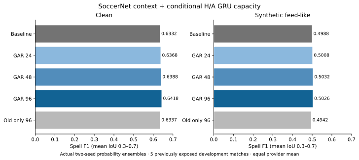

# SoccerNet-GAR capacity and data-scaling continuation

Status: **external development and one-time public diagnostic complete; no adoption**
Frozen: 30 October 2026, source commit `1b63913`  
Study ID: `soccernet_capacity_v1`  
Baseline: `joint_gru_combined_ensemble_v1`; manifest SHA-256
`c0eeeb8a11c59f2821ca306d7d7ab27052f98ccfd8ad720256d8fa3eae56baf0`; policy
SHA-256 `e5cc29d00b6608b625f3ba539ea9632565334190264f8af498c2fbb35695fcb3`.

This continuation tests whether a wider, function-preserving conditional
home/away (H/A) GRU can make better use of sparse SoccerNet event-team labels
than the fixed-capacity warm-start in [stage 1](SOCCERNET_EXTENSION.md). The
external selection, matched-control stage, and single post-selection public
diagnostic are complete. Width 96 wins on the previously exposed five-match
development cohort, but misses the predeclared +0.01 clean-spell screen. Its
public diagnostic is descriptive only and caused no tuning or adoption; the
active baseline remains adopted. Final independent replay/QC passed.

## Data preparation and QA

The input is the official SoccerNet-GAR `tracking-full` TRAIN split only: all
62,159 metadata clips from 45 2022 FIFA World Cup fixtures. Individual
decoded tracking clips contain 144 native rows (about 4.8 seconds), which is
shorter than the model context and core combined; overlapping clips are
therefore merged before windowing. The
fixtures comprise 29 group-stage games (IDs 3812–3840) and 16 knockout games
(IDs 10502–10517). The prepared source contains 5,067,781 unique valid native
frames, about 47 hours. Segmentation retained 9,905 uninterrupted records and
4,819,799 native frames, about 44.67 hours. Records split on uncovered frame
gaps, period changes, nonmonotone or long timestamp gaps, invalid rows, and
geometry conflicts; no window crosses a record or time break.

The 42,979 eligible PASS/CROSS/SHOT event-team centers map to 42,919 sampled
H/A anchors; 60 centers with conflicting team metadata remain unknown. The
official TRAIN metadata audit counts 40,745 PASS (94.80%), 1,514 CROSS (3.52%),
and 720 SHOT (1.68%) eligible events. Labels are placed at the nearest
stride-6 sample only when it is within three native
frames (about 0.1001 s). Unanchored rows, out-of-tolerance points and conflicts
remain unknown. There are no dense possession labels, inferred D labels,
forward-held labels, or event-derived negative labels. In retained records,
763,958 of 806,877 sampled targets are unknown; the remaining targets are
23,144 H and 19,775 A.

Feature extraction produces 204 named geometry/motion features from visible
player and ball observations. Estimated and smoothed entities are ignored;
team/player identity, jersey, visibility, confidence, and SoccerNet action or
possession metadata are excluded as model features. Missing values retain
finite-value masks. Source coordinates are shifted by +52.5 and +34 under a
nominal 105-by-68 m pitch assumption; this is not a fixture-specific pitch
calibration. The retained-frame ball-observed rate is 62.87%, and 27.0% of
eligible anchor frames lack an observed ball.

The observed native rate is about 29.97 Hz; features are sampled every six
native frames, about 4.995 Hz. Exact duplicate tracking rows were removed only
when period, timestamp, validity, geometry and visibility signatures agreed:
3,875,675 exact duplicate rows and zero geometry conflicts were recorded. The
segment audit verified all 45 game-cache hashes and rehashed all seven official
TRAIN source files. Its raw overlap replay cross-checked geometry and visibility
masks in four games, not every overlapping clip. A window-padding audit found
37.4% repeated endpoints in the emitted segment windows, versus 76% for the
stage-1 fixed 24-row clip windows.

An identity-only source-overlap audit maps all 45 SoccerNet games to World Cup
2022 national-team fixtures. The organizer fixture is Barcelona–Athletic; the
documented Sportec and SkillCorner fixtures are domestic club games. Metrica
fixture names remain anonymized, but its pinned source commit is dated 15 April
2021, before the 2022 World Cup. No exact Metrica opponent crosswalk is claimed.
Organizer reference labels and SoccerNet event/possession annotations were
not used for SoccerNet data preparation, fitting, or external model selection.
After that selection, the single declared public diagnostic scored the
organizer reference once. The audit conclusion is that the SoccerNet source
fixtures are disjoint from the organizer fixture and the documented benchmark
fixtures.

The private integrity receipt is
`data/experiments/soccernet_capacity_v1/segments_verification.json`; source
identity findings are in
`data/experiments/soccernet_capacity_v1/source_overlap_audit.json`. The frozen
predeclaration is
`data/experiments/soccernet_capacity_v1/predeclared.json`.

## Frozen model and fit plan

Each full-provider fold starts from its matching seed-2026 or seed-2027
factorized checkpoint. The original fold normalizer and D path stay frozen.
The candidate learns conditional H/A only and combines its H/A probabilities
with the unchanged original P(D); candidate P(D) is therefore bitwise equal to
the corresponding original member. Decoded D intervals can still move when
H/A probabilities change the sequence decoder.

The one-layer bidirectional GRU H/A widths are 24, 48 and 96 per direction,
with 62,594, 132,098 and 291,842 H/A parameters. Wider initialization copies
the teacher's 24-unit gate blocks, isolates those old recurrent units from the
new units, and initializes added output columns to zero. This preserves the
teacher's conditional H/A function at initialization. Input dropout is 0.1
during training and disabled at evaluation.

All Stage-A fits use the frozen fold normalizer, batch size 32, AdamW weight
decay `1e-4`, gradient clipping at 1, and 2,048 optimizer updates, with
checkpoints at updates 512 and 2,048. Follow-up confirmation, control, and
pooled fits stop at the selected 512- or 2,048-update budget. Stage A compares
learning rates `1e-4` and `3e-4` at all three widths. Original examples are
drawn hierarchically by source, match
and window, retaining the original paired-window augmentation choice. GAR
examples are drawn by game and window, with 50% random H/A team swaps. Half of
each batch comes from the original data and half from GAR.

The original-data H/A loss preserves the adopted complete-spell weighting
(coefficient 1) and conditional H/A transition surrogate (coefficient 0.05),
using full-native spell and transition masks. Censored spells, D, and unknown
rows are neutral or masked. GAR contributes sparse event-anchor H/A
cross-entropy only; its sparse points never create duration or transition
targets. The original checkpoint supplies P(D) throughout.

Stage A is 18 seed-2026 fits (three provider-exclusion folds × three widths ×
two learning rates), producing 36 milestone checkpoints. The 12 width/rate/
budget recipes are evaluated on the five previously exposed development
matches under clean and two fixed `feed_like` corruptions, for 195 rows
(baseline plus 12 recipes × 15 cells). Each fold excludes its evaluation
provider from all original-data learning and normalization; SoccerNet training
data are the same disjoint TRAIN set in each fold.

For each width, Stage A selects among its four learning-rate/budget recipes
using unrounded clean spell F1, then macro F1, then fewer updates and lower
learning rate. Eligibility requires each provider's clean D-F1 and macro F1
within 0.02 of the matched baseline and feed-like spell F1 within 0.01. If no
recipe passes, the best clean recipe is reported as exploratory.

Stage B fits the selected recipe at each width with seed 2027 in the three
provider folds (nine fits) and evaluates the two actual members plus their
equal-probability prediction ensemble. The 180 rows cover baseline and three
widths × three members × 15 cells. The final width is selected among guard-
eligible ensembles by unrounded clean spell F1, macro tie-break, then lower
width. A +0.01 clean spell improvement is a separate screen; there is no
automatic promotion.

After width selection, a matched original-data-only control uses the selected
width, learning rate and update budget: six fits across three folds and two
seeds, with 45 evaluation rows. This attributes any GAR effect and cannot
change the selected recipe. Two pooled deployment fits follow for the selected
width and seeds 2026/2027. The separately requested one-time public diagnostic
was reserved until external model selection and pooled seals were complete,
then run once as described below.

## External development results

All three widths selected the 2,048-update, `3e-4` learning-rate recipe.
Each passed the declared provider clean D-F1/macro and feed-like spell guards.
The two-seed results below are actual equal-probability prediction ensembles:
member probability arrays are averaged before decoding, so these numbers are
not arithmetic means of the two seed-level metric rows.

| Model | Clean spell F1 | Feed-like spell F1 | Clean macro F1 | Clean short-spell recall |
| --- | ---: | ---: | ---: | ---: |
| Active baseline | .633205 | .498830 | .854226 | .384161 |
| Width 24 | .636809 | .500844 | .854800 | .377355 |
| Width 48 | .638813 | .503157 | .854551 | .384358 |
| Width 96 | **.641790** | **.502586** | .855099 | .402145 |

Width 96 is the guard-eligible clean-score winner, with a clean gain of
+0.008585 and feed-like gain of +0.003756 over the baseline. It misses the
separate +0.01 clean improvement screen by 0.001415; no automatic promotion
was authorized. Provider guards pass, although width-96 SkillCorner clean
D-F1 is .743381 versus .746889 for baseline, and Sportec feed-like spell is
.470310 versus .473066. Clean spell F1 by provider is .807661 Metrica,
.462494 SkillCorner, and .655215 Sportec; feed-like is .609549, .427898, and
.470310. Clean IoU .3/.4/.5/.6/.7 scores are
.726266/.704103/.654868/.598293/.525418 versus baseline
.723165/.695803/.646311/.587839/.512906. Feed-like IoUs are
.612190/.569328/.507142/.445578/.378692 versus
.610564/.570382/.503104/.438757/.371340.

The matched width-96, equal-budget old-data-only control scored .633652 clean
and .494188 feed-like. The SoccerNet-trained ensemble exceeds it by +.008138
clean and +.008398 feed-like. This is a matched comparison on the same exposed
cohort; the control did not reselect width or recipe. Width-96 clean/feed-like
short-spell recall is .402145/.212810 versus
baseline .384161/.203371. Complete aggregate rows, seed summaries, provider
metrics and spell counts are in
`data/experiments/soccernet_capacity_v1/final_report.json`; control rows are in
`control_report.json`.

These results characterize performance within the declared capacity/data
recipe. Widths were compared under the same GAR-augmented schedule, and the
matched old-only control uses the selected width and equal update budget. The
comparison does not isolate a capacity-only causal effect from data scaling
and preparation differences. All five evaluation matches had prior exposure,
and the +0.01 clean screen fails, so keep the adopted baseline.

## One-time public diagnostic

Only after external selection and pooled checkpoints were sealed, the declared
width-96 recipe was run once on the public window. Its primary mean spell F1
is .569697 versus .557576 for the saved baseline (+.012121); macro F1 is
.861288 versus .854088 (+.007201), and D-F1 is .855417 versus .854810
(+.000607). Both outputs contain 16 predicted spells against 17 references
across 7,500 graded frames. At IoU .5, the candidate matches 11 references,
with five spurious and six missed; the baseline matches ten, with six spurious
and seven missed. The candidate and baseline bootstrap 5–95% intervals for
mean spell F1 are [.400000, .739394] and [.387879, .727273], respectively.
The small exposed window makes this a noisy pipeline diagnostic, not
confirmation. The score was not used for model selection, tuning, or adoption;
full-match performance remains unknown. The sealed aggregate is
[`soccernet_capacity_public_check.json`](results/soccernet_capacity_public_check.json).

## Evaluation and limitations

The primary cohort is the known five-match full-provider development set:
Sportec J03WOY, Metrica Game 3, and SkillCorner 1996435, 1996436 and 2006229.
These matches were previously evaluated; this is not independent confirmation.
The clean view and synthetic `feed_like` views use the frozen split, labels,
baseline and scoring code. Stress performance is diagnostic, not evidence of
real broadcast robustness. Report seed members separately from their actual
prediction ensemble and aggregate matches within providers before giving equal
weight to providers.

The declaration fixes provider clean D-F1 and macro floors of baseline minus
0.02, feed-like spell floor of baseline minus 0.01, and a +0.01 clean spell
improvement screen. Full-match accuracy and independent confirmation are not
measured. The one-time public window has only 7,500 graded frames and 17
possessions; it is not a model-selection set and will not drive tuning. The
44.67 hours describe retained tracking context, not possession ground truth:
supervision consists of 42,919 sparse event-team points, while most sampled
targets remain unknown. Frames between anchors receive no dense labels.

Before fitting, 349 experiment tests, 18 root tests, and the exact file-backed
fit contract passed; the final suite passed 353 experiment tests and 18 root
tests. Exact file-backed fit parity and CSV-format checks also passed.
Independent QC passed coarse (36 checkpoints, 195 metric rows and 12
weight-to-prediction replays), selected-final (180 rows), matched control (45
rows), pooled checkpoint, and public prediction checks. The public verifier
regenerated the prediction from sealed weights and exactly reproduced the
saved probabilities and CSV; it opened no reference file and did not rescore
metrics. The public result itself was scored once by the separate gate. The
runtime profile is in
`data/experiments/soccernet_capacity_v1/runtime_profile.json`.

Runtime-only audit amendments are preserved in private receipts. A reader
adapted the frozen confirmation-seal table names (`coarse_models` and
`selected_models`) to the generic `models` view without changing seals. The
final parity lookup was corrected to compare matching baseline members
(2026, 2027, or ensemble); numeric tolerances, metrics, weights, probabilities,
and selection were unchanged. An independent checker correction removed one
invalid assertion equating an ensemble's D values with its seed-2026 member;
the matching-member and actual-ensemble D checks remain. Original checker
bytes/traceback, amendments, and executed-function-byte receipts are
preserved.

Detailed sealed reports and verification receipts are linked here:
[coarse selection](results/soccernet_capacity_coarse_report.json),
[final external results](results/soccernet_capacity_final_report.json),
[matched control](results/soccernet_capacity_control_report.json),
[public diagnostic](results/soccernet_capacity_public_check.json),
[independent verification](results/soccernet_capacity_verification.json), and
[artifact receipt](results/soccernet_capacity_artifacts.json).

All weights, segment records, source snapshots, private verification receipts
and frame-level outputs remain local. The inventory hashes 1,187 files (about
1.96 GB), including stage 1 and capacity artifacts; it is a local integrity
inventory, not a restorable remote backup. Raw SoccerNet data require
authorized access. No private archive upload is claimed, consistent with the
data license. The adopted baseline and negative stage-1 result remain
unchanged.
