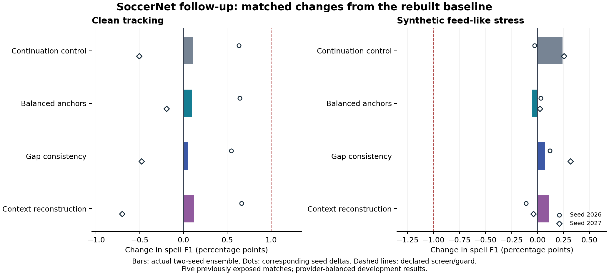

# SoccerNet matched training follow-up

Completed 30 October 2026: `soccernet_followup_execution_v1`.
Source implementation: `df309c8`; all fit and evaluation sources are hash-bound
by the declarations. This completes the three parallel Luna implementations
in [the original protocol](SOCCERNET_TRAINING_IDEAS.md).

## Decision and measured results

**Retain `joint_gru_soccernet_capacity_ensemble_v1`.** All three ideas produce
small clean point-estimate gains over the reproduced baseline, but none meets
the predeclared +.01 clean spell-F1 screen. Context reconstruction is the clean
numerical leader at .642988, versus baseline .641790 and matched continuation
.642896. Its advantage over the same-budget control is only +.000092 clean,
with a -.001307 feed-like loss. The control has the best feed-like score,
.504988. These results do not establish a useful advantage from any new objective.

All provider clean macro/D-F1 guards and the feed-like floor pass. That does
not turn the failed clean improvement screen into a pass. No model is promoted.
The rebuilt reference matches all published width-96 seed, ensemble and
provider metrics exactly: maximum difference 0, with the
declared comparison tolerance 1e-9. This is numerical reproduction, not a claim
to restore the original checkpoint bytes.

| Method | Clean spell | Clean macro | Clean 70/30 | Feed-like spell | Feed-like macro | Feed-like 70/30 |
| --- | ---: | ---: | ---: | ---: | ---: | ---: |
| Rebuilt baseline | 0.641790 | 0.855099 | 0.705782 | 0.502586 | 0.810985 | 0.595106 |
| Continuation control | 0.642896 | 0.854787 | 0.706463 | 0.504988 | 0.810986 | 0.596788 |
| Balanced anchors | 0.642737 | 0.855363 | 0.706525 | 0.502087 | 0.810098 | 0.594491 |
| Gap consistency | 0.642290 | 0.854826 | 0.706051 | 0.503302 | 0.811387 | 0.595728 |
| Context reconstruction | 0.642988 | 0.855093 | 0.706619 | 0.503681 | 0.810244 | 0.595650 |

Spell F1 determines rank; macro breaks exact ties. The 70/30 column is auxiliary.
All ensemble scores use averaged native probabilities before decoding.

| Method | Clean vs baseline | Feed-like vs baseline | Clean vs control | Feed-like vs control |
| --- | ---: | ---: | ---: | ---: |
| Continuation control | +0.001106 | +0.002402 | +0.000000 | +0.000000 |
| Balanced anchors | +0.000948 | -0.000498 | -0.000158 | -0.002901 |
| Gap consistency | +0.000501 | +0.000716 | -0.000605 | -0.001686 |
| Context reconstruction | +0.001198 | +0.001095 | +0.000092 | -0.001307 |

Bars are ensemble deltas; dots are paired per-seed deltas, not confidence
intervals. The dashed lines show the frozen clean screen and feed-like floor.

## Provider and seed variation

| Method | Sportec clean spell | Metrica clean spell | SkillCorner clean spell |
| --- | ---: | ---: | ---: |
| Rebuilt baseline | 0.655215 | 0.807661 | 0.462494 |
| Continuation control | 0.664068 | 0.800549 | 0.464070 |
| Balanced anchors | 0.663235 | 0.797814 | 0.467162 |
| Gap consistency | 0.664390 | 0.800000 | 0.462481 |
| Context reconstruction | 0.661783 | 0.800000 | 0.467182 |

Every continuation loses clean spell F1 on Metrica; gains come from the other
providers. Metrica also drives the largest feed-like losses against the
continuation control: -.008512 for balancing, -.007155 for gap consistency,
and -.004571 for reconstruction. The gap arm improves SkillCorner feed-like
spell over the control by +.002647, but that does not offset its other losses.

| Method | 2026 clean | 2027 clean | 2026 feed-like | 2027 feed-like |
| --- | ---: | ---: | ---: | ---: |
| Rebuilt baseline | 0.628775 | 0.638351 | 0.494569 | 0.497485 |
| Continuation control | 0.635120 | 0.633285 | 0.494302 | 0.500027 |
| Balanced anchors | 0.635219 | 0.636407 | 0.494877 | 0.497728 |
| Gap consistency | 0.634247 | 0.633563 | 0.495752 | 0.500650 |
| Context reconstruction | 0.635429 | 0.631348 | 0.493466 | 0.497086 |

All four continuations improve seed-2026 clean scores and reduce seed-2027
clean scores. Reconstruction's clean changes versus its corresponding
reference are +.006654 and -.007003; both individual feed-like scores decline
even though the actual ensemble improves slightly. Two seeds and five exposed
matches do not establish independent confirmation or a stable gain.

## Diagnostics and attribution limits

| Provider-balanced mean | Baseline clean | Reconstruction clean | Baseline feed-like | Reconstruction feed-like |
| --- | ---: | ---: | ---: | ---: |
| D-F1 | 0.848806 | 0.847941 | 0.844050 | 0.844288 |
| D precision | 0.908222 | 0.908122 | 0.897810 | 0.898418 |
| D recall | 0.800695 | 0.799307 | 0.800023 | 0.800047 |
| Short-spell recall | 0.402145 | 0.398546 | 0.212810 | 0.213403 |
| Reference spells | 404.333333 | 404.333333 | 404.333333 | 404.333333 |
| Predicted spells | 372.333333 | 370.777778 | 320.888889 | 324.111111 |
| Fragmented reference spells | 7.888889 | 7.000000 | 7.055556 | 8.055556 |

Counts are means within provider, then across providers, not corpus totals.
The full [aggregate](results/soccernet_followup_results.json) records every arm,
provider, seed, all five IoU thresholds and both views. Graded-frame and reference
spell populations are identical across methods. Frozen P(D) is exact, although
joint decoding can still change D predictions and their metrics.

The [balancing audit](results/soccernet_followup_anchor_diagnostics.json) finds
42,919 weighted anchor rows, with 2,220 (5.17%) at the cap. Post-cap mean weight
is .591960: 59.2% of the pre-cap normalized mass remains. The recipe reduces
PASS dominance but also changes GAR loss scale; it is not an isolated test of
event composition. The frozen recipe was not changed after this audit.

Reconstruction does not recover the broad short-spell deficit: clean short-spell
recall is .398546 versus baseline .402145; feed-like is .213403 versus .212810.
The auxiliary objectives were active in real fits, with finite, nonzero losses
in their recorded histories. Additional forward passes add training compute;
the auxiliary reconstruction head is discarded at inference.

## Verification and next action

Six reference rebuilds and all 24 continuation fits completed. The final model
seal contains all 30 heads and receipts and verifies six matched supervised-draw
hashes across all four arms. All 30 original-teacher probability comparisons
are exact, with exact decoded parity. Saved score replay verifies 225 rows and
arrays, and independent weight replay reproduces all 150 seed arrays, 75
ensemble arrays and 225 decoded outputs exactly.

Validation: 406 experiment tests, 18 root tests, exact file-backed fit parity,
and the bundled 199,319-row CSV format check pass. No new organizer scoring
occurred. See [verification](results/soccernet_followup_verification.json),
[weight replay](results/soccernet_followup_weight_replay.json),
[decision readout](results/soccernet_followup_readout.json),
[rebuild declaration](results/soccernet_followup_rebuild_declaration.json),
[continuation protocol export](results/soccernet_followup_declaration.json), and
[model seal](results/soccernet_followup_model_seal.json).

The public protocol export omits 9,905 per-record anchor summaries and records
the full private declaration's SHA-256. The immutable full declaration remains
in the local checkpoint bundle; model and evaluation seals bind that full file.

The current baseline and closed organizer scoring records remain unchanged.
Prioritize a fresh, densely possession-labelled external cohort before another
adoption decision; this study supplies no qualifying upgrade. The new models
are provider-held-out research checkpoints, not a pooled deployment package.
The [artifact receipt](results/soccernet_followup_artifacts.json) binds a local
inventory and checkpoint bundle, including matching original D teachers.
They have not been uploaded to a remote archive.

## Protocol and provenance

The selected width-96 fold checkpoints and their private inventory were not
available in the restored archive. This study therefore explicitly rebuilds
six reference heads from the original, hash-verified combined-objective fold
teachers. It does not claim to restore the promoted package's original bytes.
The rebuild uses the recorded selected recipe: width 96, learning rate 3e-4,
2,048 updates, batch size 32, and equal old-data/SoccerNet windows. Original
normalization and D teachers remain frozen. A separate immutable rebuild
declaration precedes these fits; a second declaration freezes continuation
inputs and reference hashes before the 24 continuation fits.

SoccerNet-GAR TRAIN data were recovered from
[Hugging Face](https://huggingface.co/datasets/OpenSportsLab/SoccerNet-GAR/tree/tracking-full)
at revision `32c840210b7d08d06976e7f9457dfff79fb2da99`. All seven source-file
hashes match the historical capacity declaration. The new acquisition receipt
has its own timestamp and hash. Continuous segments are rebuilt using the
unchanged historical assembler. Sparse PASS/CROSS/SHOT actor-team anchors are
H/A silver labels; unlabeled rows remain unknown. Neither context duration nor
event labels provide dense possession or D ground truth.

Each reference is continued for 512 updates at learning rate 1e-4 under four
fixed arms: the unmodified continuation control, event-balanced anchors,
raw ball-gap consistency, and masked context reconstruction. Supervised draws
are matched across arms and checked by hash. The auxiliary arms require extra
forward passes, so the budget matches updates, not wall-clock compute.

The event-balancing recipe normalizes positive anchor weights to mean one
before clipping at five. Clipping can reduce their final mean, and therefore
the effective scale of the GAR loss. This arm tests that combined weighting
recipe; it does not isolate event composition from loss scale. The declaration
records the actual post-cap mean and fraction at the cap.

Gap views remove ball observations in raw tracking before recomputing features.
Each recovered clean view must reproduce the base segment exactly. A fixed
identity-derived seed determines the prepared gap for each segment, shared
across model seeds. Only newly hidden, originally observed, valid core rows
with frozen H/A teacher confidence at least .8 receive the auxiliary KL loss.
Context reconstruction hides valid core rows and reconstructs naturally
observed normalized features through a disposable decoder. Neither mechanism
adds possession labels or changes inference decoding.

## Evaluation

Every learned component excludes the evaluated provider: H/A, D, and the
original normalizer. The five previously exposed development matches are
Sportec J03WOY, Metrica Game 3, and SkillCorner 1996435/1996436/2006229.
The canonical manifest, exact match identifiers, and cache hashes are frozen
in the declarations. SoccerNet's 45 TRAIN fixtures are shared across folds.

The grid comprises clean and two fixed synthetic `feed_like` views for each
match: 15 cells, five arms including the rebuilt reference, and three members
(seed 2026, seed 2027, actual two-seed probability ensemble). All 30 models are
sealed before scoring. The evaluator first checks all 30 original teacher
outputs against archived probabilities (absolute tolerance 1e-6) and requires
exact decoded prediction parity. Conditional H/A inference preserves each
teacher's native P(D). Ensemble probabilities are averaged before cost-3
decoding using the historical arithmetic.

Official spell F1 ranks first, with macro F1 breaking exact ties; the 70/30
summary is auxiliary. Scores average within provider, then equally across
providers. The predeclared screen is +.01 clean spell over the rebuilt
reference, with `feed_like` spell no worse than -.01 and each provider's clean
macro/D-F1 no worse than -.02. Both seeds, all five IoU thresholds, short-spell
recall, spell counts, fragmentation, and D precision/recall are reported.
The rebuilt reference is compared numerically with the published capacity
report at tolerance 1e-9; any discrepancy remains explicit.

These are reused development matches and synthetic stress, not independent
confirmation. This execution does not access organizer labels, reopen a public
scoring gate, or automatically promote a model.

## Reproduction and artifact availability

Raw data, cached arrays, weights, frame predictions, and private fit receipts
remain under ignored local directories. The new study's inventory establishes
local integrity; it is not a remote restoration archive. Original fold teachers
and old-data caches came from the verified private LFS archive.

Use `MTAH_DATA_DIR=/workspace/mtah-data` for the restored old cache and
`MTAH_EXECUTION_DIR=<repository>/data` for new outputs. The executor provides
`freeze-rebuild`, `fit-reference --fold <fold> --seed <seed>`,
`freeze-followup`, `fit-followup --fold <fold> --seed <seed> --arm <arm>`, and
`seal`. The separate evaluator provides `evaluate` and `verify`, both with
`--execution-dir <repository>/data/experiments/soccernet_followup_execution_v1`.
Completed outputs and changed declared inputs fail closed.
