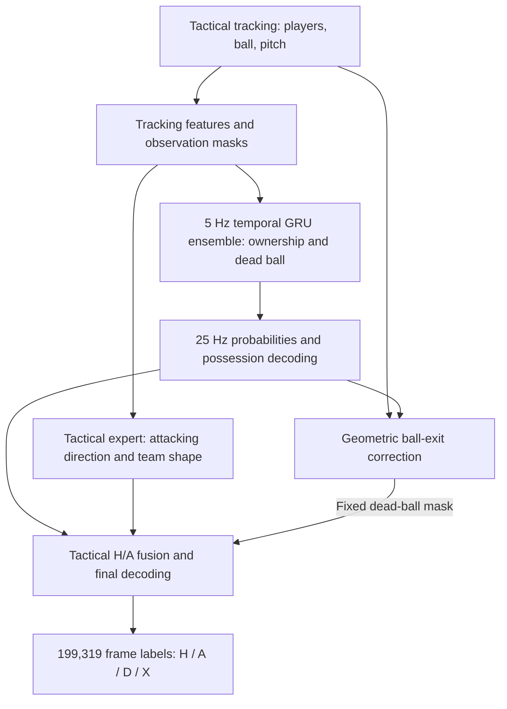

# Tracking-based football possession — Douki Douki

More Than A Hack 2027 · 16 November 2026



Temporal and tactical models combine with a ball-exit rule to produce labels.
This offline system uses past and future context. H/A denote home/away possession, D dead ball, and X frames
outside the tracking-defined halves.

## Data

Challenge-match inputs are `BAR-ATH_tactical_atd.xml` and `.txt`:
pitch geometry, team assignments, players and ball. Tactical video was inspected
to understand the feed, without creating labels or corrections. Broadcast
video/tracking and homographies were unused; Smart Tagging was audited and
dropped because its phases are not possession labels. No manual annotations,
human-produced events or private ground truth from this match enter the system.

All learning uses other matches:

| Dataset and source | Training amount | Label producer and construction |
| --- | --- | --- |
| [Sportec Open DFL, v1](https://doi.org/10.6084/m9.figshare.28196177.v1), CC BY 4.0 | 3 matches: J03WMX/J03WN1/J03WOH | Sportec Solutions/DFL `BallStatus` and `BallPossession` channels. |
| [Metrica Sports sample data](https://github.com/metrica-sports/sample-data) | Games 1–2 | Fixed H/A/D conversion of Metrica's human-annotated events. |
| [SkillCorner open data](https://github.com/SkillCorner/opendata), MIT, revision `4340d27` | 8 A-League matches | Provider `possession.group` for H/A and `game_interruption` for D; 1 s unknown margins. |
| [SoccerNet-GAR tracking-full](https://huggingface.co/datasets/OpenSportsLab/SoccerNet-GAR), revision `32c8402`, gated access | 45 TRAIN games | Algorithmic dense H/A/D silver labels from dataset touch/event columns; not human frame-level possession annotations. |

The temporal ensemble uses all 13 original matches and 45 GAR TRAIN games.
The tactical expert uses only the 13 original matches. Unknown targets and
match, half and segment breaks are preserved. Organizer public labels are used
only for a post-selection diagnostic, never training, tuning or selection.

## Features

ATD coordinates are converted to pitch metres. At 5 Hz, 137 team/ball features
capture nearest-player distances, contact history, ball motion and gaps;
67 player-only features capture observation masks, player counts, speeds and
rolling motion summaries. Raw missingness masks are retained; tactical features
fill short ball gaps. Training includes player-slot dropout and synthetic gaps.

The tactical expert uses 97 features: inferred attacking direction per team and
half; oriented ball position, velocity and progress; ball position relative to
team centroids and lines; players ahead of the ball; team spread and motion.
Direction comes from player locations.

## Modeling

Bidirectional gated recurrent units (GRUs) process 10 s cores with 5 s context
on each side. Conditional H/A prediction separates ownership from a
player-only dead-ball path, reducing reliance on provider-specific ball visibility.
H/A hidden width is 96; the teacher's D path uses width 24.

Three temporal branches combine H/A probabilities with weights 0.5/0.375/0.125:
a cross-entropy continuation, a dense-label model, and a model with diversified
possession sampling. The diversified branch supplies the initial dead-ball mask.
Each uses seeds 2026 and 2027. Each sampling offset's predictions are interpolated
to 25 Hz, then averaged across seeds within offsets and across offsets.
Ten checkpoint roles include the branches and paired teachers.

Dense training combines frame, complete-possession and transition supervision,
with 50% GAR windows. Cross-entropy continuation uses 512 updates at `3e-4`,
then 512 at `1e-4`, 32-window batches, equal original/GAR sampling,
distinct-possession sampling and four fixed corruption views. Released checkpoints
freeze the exact model used for the submitted file.

A HistGradientBoosting classifier predicts home ownership given live play.
It trains on 5 Hz live frames, clean and one synthetic `feed_like_v2` view,
with equal provider/match/view weighting. Direct and team-swapped examples
are used in training, and both inference passes are averaged.

## Postprocessing

A temporal decoder penalizes H/A switches with cost 3 to suppress flicker.
The frozen ball-exit rule moves dead-ball starts toward observed pitch exits,
using zero pitch margin, a 3 s advance window and a 5 s delay window.
The tactical expert contributes 0.25 times its log-odds to temporal H/A log-odds,
except inside initially decoded possessions shorter than 5 s. H/A is decoded
again within the unchanged corrected dead-ball mask.

The label convention retains the last controlling team through loose balls,
challenges and rebounds until controlled opponent contact. GAR silver labels
implement this explicitly; an OUT event starts D until the next touch. At
inference, tracking models and the exit rule estimate those boundaries without
challenge-match events. Every frame inside the two tracking-defined halves
receives H/A/D; outside frames receive X. There are no manual frame corrections.

## Eval

Whole matches are separated for fitting and evaluation. Development uses
Sportec J03WOY, Metrica Game 3 and SkillCorner 1996435/1996436/2006229.
The tactical expert is also held out by provider; upstream components do not
constitute a fully nested provider holdout. We average matches within each
provider, then providers equally. Each match is evaluated on clean tracking and
four fixed `feed_like_v2` stress realizations. This simulator uses label-free
challenge-feed statistics to calibrate ball gaps, player dropout, tracking noise
and identity switches, with missingness concentrated around stoppages.

The exact deployed pooled package is checked on three additional Sportec
matches (J03WPY/J03WQQ/J03WR9) and ten GAR TEST games. Neither set enters
fitting. Corruption scores average four realizations within each game, then
games equally. Nine selected-on GAR VALID games remain separate from TEST.

The official ranking metric, spell F1, matches H/A possessions one-to-one by
temporal intersection over union (IoU), averaging F1 at thresholds 0.3, 0.4,
0.5, 0.6 and 0.7. Macro F1 averages frame-level F1 across H/A/D. Final results:

| Evaluation set | Clean spell F1 | Feed-like v2 spell F1 |
| --- | ---: | ---: |
| Five exposed development matches | 0.681742 | 0.603079 |
| Three additional Sportec matches | 0.744783 | 0.662575 |
| GAR TEST, ten games | 0.716648 | 0.715728 |

The organizer diagnostic covers 7,500
frames and 17 possessions: spell F1 **0.623529**, macro F1 **0.870218**,
D-F1 **0.889372**. The spell bootstrap 5–95% interval is [0.458824, 0.776471].
Full-match organizer performance is unknown. Sources:
[tactical evaluation](https://github.com/jekkiechan/more-than-a-hack-2027/blob/submission-2026-v1/experiments/TACTICAL_HA_V1.md)
and [public diagnostic](https://github.com/jekkiechan/more-than-a-hack-2027/blob/submission-2026-v1/experiments/TACTICAL_PUBLIC_V1.md).

Development selection included about 56 tactical fusion variants.
The clean short-possession recall guard was not satisfied;
adoption prioritized overall spell F1. GAR has silver labels, discontinuous
segments and repeated TEST exposure. Sportec is also a training provider;
two extra matches had prior evaluation exposure. V2 corruption is
model-conditioned and uses development labels in its construction. The reused
public window is small. These protocols cannot be pooled or treated as
independent continuous-match gold confirmation.

Long ball gaps can preserve a wrong owner, smoothing can merge brief possessions,
and unseen exits can defeat geometric correction. Further work needs independent,
continuously annotated matches and improved automatic tracking.

## How to reproduce

The frozen package is
`joint_gru_sn_dense_spell_frontier_ball_exit_tactical_ensemble_v1`.
[Public source and weights](https://github.com/jekkiechan/more-than-a-hack-2027/releases/tag/submission-2026-v1)
are pinned by `submission/model_manifest.json` and `submission/weights.json`.
On Linux with Python 3.12:

```sh
git clone --branch submission-2026-v1 https://github.com/jekkiechan/more-than-a-hack-2027.git
cd more-than-a-hack-2027
python3.12 -m venv .venv
. .venv/bin/activate
python -m pip install -r submission/requirements.txt
python -m pip install torch==2.8.0 --index-url https://download.pytorch.org/whl/cpu
```

Place the organizer's tactical ATD `.xml` and `.txt` files in `data/tactical/`, then run:

```sh
bash submission/make_submission.sh 'Douki Douki'
```

The wrapper verifies downloaded weights, prepares tracking without reference
labels, predicts with one CPU thread, validates format and checks the hash.
Clean-environment reproduction is verified. Output:
`data/submission/Douki Douki.csv`, 199,319 rows and 281 predicted possessions;
existing CSVs are not overwritten. Expected SHA-256:

```text
8e26f823a3e933f1feca2a64dfe6d7f728a4741548c8c7cd95d51746b6a355b9
```
