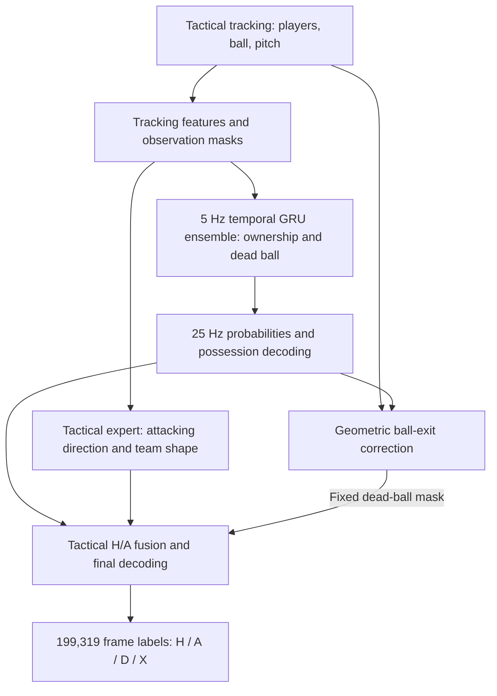
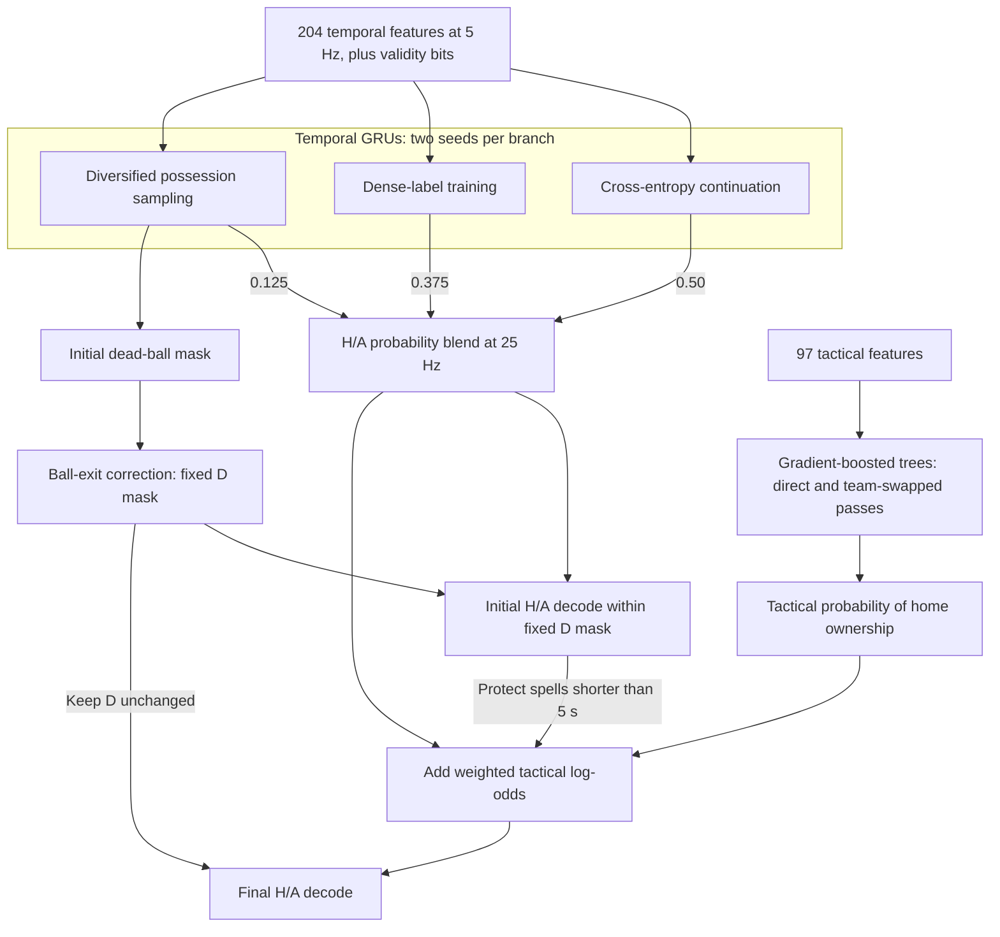
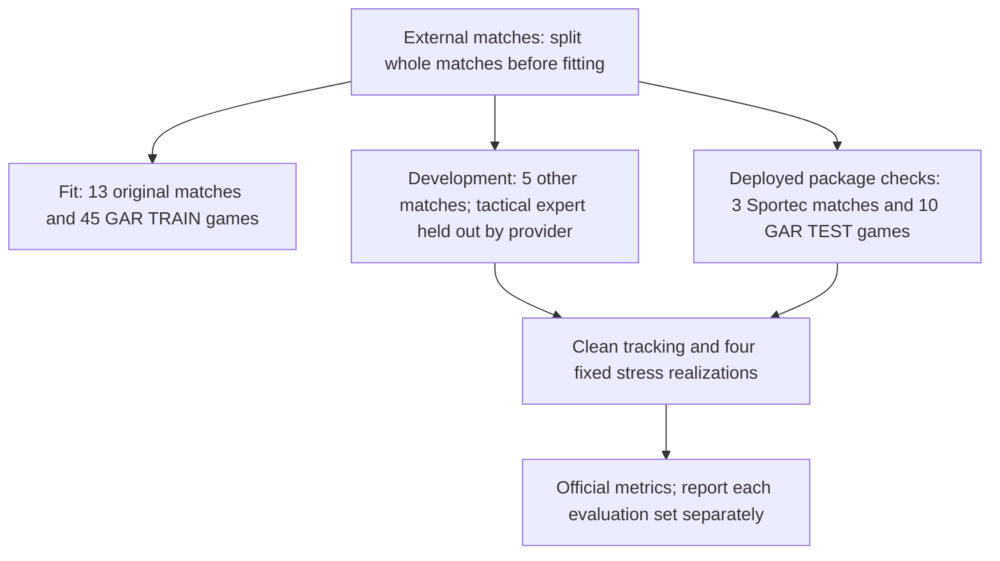

# Tracking-based football possession — Douki Douki

More Than A Hack 2027 · 16 November 2026



Temporal and tactical models combine with a ball-exit rule to produce labels.
This offline system uses past and future context. H/A denote home/away possession, D dead ball, and X frames
outside the tracking-defined halves.

## Data

Challenge-match inputs are `BAR-ATH_tactical_atd.xml` and `.txt`:
pitch geometry, team assignments, players and ball. Tactical video was inspected
to understand the feed, without creating labels or corrections. Broadcast
video/tracking and homographies were unused; Smart Tagging was audited and
dropped because its phases are not possession labels. No manual annotations,
human-produced events or private ground truth from this match enter the system.

All learning uses other matches:

| Dataset and source | Training amount | Label producer and construction |
| --- | --- | --- |
| [Sportec Open DFL, v1](https://doi.org/10.6084/m9.figshare.28196177.v1), CC BY 4.0 | 3 matches: J03WMX/J03WN1/J03WOH | Sportec Solutions/DFL `BallStatus` and `BallPossession` channels. |
| [Metrica Sports sample data](https://github.com/metrica-sports/sample-data) | Games 1–2 | Fixed H/A/D conversion of Metrica's human-annotated events. |
| [SkillCorner open data](https://github.com/SkillCorner/opendata), MIT, revision `4340d27` | 8 A-League matches | Provider `possession.group` for H/A and `game_interruption` for D; 1 s unknown margins. |
| [SoccerNet-GAR tracking-full](https://huggingface.co/datasets/OpenSportsLab/SoccerNet-GAR), revision `32c8402`, gated access | 45 TRAIN games | Algorithmic dense H/A/D silver labels from dataset touch/event columns; not human frame-level possession annotations. |

The temporal ensemble uses all 13 original matches and 45 GAR TRAIN games.
The tactical expert uses only the 13 original matches. Unknown targets and
match, half and segment breaks are preserved. Organizer public labels are used
only for a post-selection diagnostic, never training, tuning or selection.

## Features

**Align, clean and sample the tracking.** Each tactical ATD row maps to a video
frame; normalized coordinates are scaled by the pitch dimensions into metres.
Team membership comes from track-slot metadata. Computation resets at match,
half and timestamp breaks, so derivatives and rolling windows cannot bridge
unrelated periods. Internal ball gaps of at most 0.5 s are linearly interpolated;
longer gaps stay missing, and original observation flags are retained. Speeds
come from position differences multiplied by frame rate; implausible player
jumps are excluded from motion summaries. We compute features on the native
frame timeline and sample 5 Hz sequences for temporal modeling.

**Temporal inputs: 137 team/ball features plus 67 player-only features.**
The following families turn coordinates into evidence about control and stoppages:

| Feature family | How it is constructed and what it captures |
| --- | --- |
| Proximity and pressure | For each team, sort player-to-ball distances; keep the nearest three, counts within 2/5/10 m, and visible-player counts. Subtract home distance from away distance to measure the home team's proximity advantage. |
| Contact history | At 1/2/3 m proximity thresholds, record the nearest team's last and next close approach and the elapsed time to each. These are geometric contact proxies that preserve evidence through passes and loose-ball intervals. |
| Ball motion and boundaries | Differentiate ball positions to obtain speed, acceleration and turning; measure distance to the nearest pitch edge and velocity directed out of that edge. This describes kicks, deflections and exits. |
| Player–ball motion | For the nearest two players of each team, compute relative speed, closing speed and motion alignment. Combine proximity with shared motion into continuous control evidence; proximity with ball acceleration gives a contact-impulse proxy. |
| Missingness and short context | Keep raw observation/availability flags and time since/until an observed ball position. Centered rolling means summarize distances, nearest-team votes, speeds and visibility over short intervals. Future observations are allowed because inference is offline. |
| Player-only stoppage evidence | Aggregate speed mean, spread and quantiles; fractions moving slowly/quickly; motion coherence; squad spread; touchline occupancy; and team-centroid separation. Add centered summaries, typically at ±0.3/1/3 s. This 67-feature block uses no ball data. |

For example, a home player near the ball and moving with it provides stronger
control evidence than proximity alone. A mostly stationary squad with stable
team separation supplies dead-ball evidence even when the ball disappears.
Team aggregates and nearest-player ranks limit dependence on stable player IDs.

GRU preprocessing subtracts training-set feature medians, divides by training-set
standard deviations and clips standardized values to ±10. Missing values become
zero with a separate validity bit, producing 408 inputs from 204 raw features.
The dead-ball path receives only the player-only values and their validity bits.
All normalization statistics are fitted on training inputs and reused unchanged.

**Tactical inputs: 97 direction-aware features.** We infer each team's attacking
direction from the ordering of the teams' mean longitudinal positions over a
half. Coordinates are centered on the pitch and the longitudinal axis is oriented
to express progress in the team's attacking direction. For each frame we derive:

- **Ball progress:** oriented position and velocity, plus the difference between
  mean future and past ball positions over 2 s and 5 s horizons.
- **Ball relative to team shape:** distance along the pitch from ball to team
  centroid, second-deepest visible player (a defensive-line proxy) and most
  advanced player; fraction of visible players ahead of the ball; player counts
  within 10/20 m and mean player-to-ball distance.
- **Collective movement:** centroid and defensive-line forward speed, longitudinal
  and lateral spread, separation between team centroids, and centered ±1/3 s
  summaries. Counts and missing values describe partial visibility.

This gives the tactical expert field position and team structure beyond local
ball-contact evidence. Its boosted trees handle missing feature values directly.

## Modeling

The model has two complementary sources of ownership evidence: temporal tracking
context and team-level tactical structure. The diagram shows their outputs and
how the postprocessing below combines them.



### Temporal backbone and training objective

A gated recurrent unit (GRU) is a neural network that carries information along a
sequence. Bidirectional GRUs read both forward and backward, allowing observations
on either side of a ball gap to inform ownership. Each input window contains a
10 s prediction core plus 5 s context on either side; only the core is emitted.
The H/A network has hidden width 96. A separate player-only dead-ball network
uses width 24, avoiding provider-specific ball-visibility shortcuts at stoppages.

The ownership output is conditional: the probability of home versus away
possession **given that play is live**. Dead-ball probability is estimated
separately. Dense supervision supplies a target at every known training frame,
including algorithmically generated GAR silver labels; unknown targets are
excluded. Frame-level cross-entropy penalizes assigning low probability to the
correct team: a home-owned frame with predicted home probability 0.9 incurs
`-log(0.9)`. Possession-based weighting limits long runs' dominance, while a
transition term supervises ownership changes between neighboring frames. These
terms connect frame accuracy with the whole-possession ranking metric.

### The three temporal branches

All three branches share this temporal representation; they differ in training
history or sampling. Their H/A probabilities are blended as shown in the diagram.

1. **Dense-label branch — weight 0.375.** Train on known frame-level H/A/D targets
   from the 13 original matches and 45 GAR games, using frame, possession and
   transition supervision. Both ownership and the player-only D path are learned.
   This provides broad supervision across ordinary play and stoppages.
2. **Diversified-possession branch — weight 0.125.** Use the same dense targets,
   but deliberately spread training exposure across distinct short possessions.
   On original-provider data, 25% of eligible window draws are replaced by windows
   overlapping complete possessions of at most 3 s, cycling through a shuffled
   bag before reuse. GAR short-spell sampling additionally requires corroborating
   touch/geometry evidence. Labels are unchanged. This gives brief possessions
   more varied exposure than repeated random windows; this branch also supplies
   the initial dead-ball mask.
3. **Cross-entropy continuation — weight 0.5.** Start from the trained diversified
   ownership checkpoint and continue updating its H/A weights, rather than
   initializing a new network. The principal loss remains cross-entropy on known
   live frames, with the existing possession weights and transition term retained.
   The D network and normalization are frozen. Train for 512 updates at learning
   rate `3e-4`, followed by 512 at `1e-4`, cycling through four fixed tracking views.
   This adapts team attribution to feed defects without changing the learned
   stoppage detector. “Continuation” refers to this additional training stage.

Training batches have 32 windows, half from original providers and half from GAR,
so the larger GAR collection cannot dominate. Each branch uses seeds 2026/2027.
At 25 Hz there are five possible 5 Hz sampling offsets; each offset's predictions
are interpolated to the full timeline, then averaged across seeds and offsets.
This reduces sensitivity to initialization and which frames enter a sampled
sequence. Ensemble weights are selected on external development data.

### Tactical expert and combination

HistGradientBoosting is an ensemble of decision trees fitted sequentially, with
later trees correcting remaining prediction errors. It captures nonlinear
relationships in the 97 tactical features and outputs home-ownership probability
on live frames. It adds attacking direction and team shape to the temporal
models' local tracking evidence.

The classifier trains on 5 Hz live frames from the 13 original matches, with
clean and one synthetic `feed_like_v2` view, weighted equally by provider, match
and view. Team-swapped training examples exchange H/A identities and targets.
At inference, direct and swapped probabilities are mapped back to the same team
identity and averaged. This reduces dependence on home/away naming. The expert
supplies additional H/A evidence; postprocessing combines it with the temporal
ensemble while preserving the corrected dead-ball mask.

Released checkpoints freeze the exact models used for the submitted file.

## Postprocessing

Weights, decoder cost and timing windows were selected on external development
data and frozen before final package checks.

- **Suppress possession flicker.** A temporal decoder applies an H/A switch cost
  of 3. This discourages brief unsupported changes that split one possession into
  several and hurt the whole-possession ranking metric.
- **Align stoppages with observed exits.** The ball-exit rule moves dead-ball
  starts toward tracking-observed pitch exits, with zero pitch margin, a 3 s
  advance window and a 5 s delay window. This uses direct geometric evidence
  to refine boundaries inferred from slower-changing player motion.
- **Fuse cautiously.** Add 0.25 times tactical log-odds to temporal H/A log-odds,
  except inside initially decoded possessions shorter than 5 s. The modest weight
  adds tactical context while short-spell protection avoids directly reweighting
  already brief possessions. Final decoding keeps the corrected D mask fixed:
  the tactical expert can change the owning team, but cannot create stoppages.
- **Apply the possession convention.** Loose balls, challenges and rebounds stay
  with the last controlling team until controlled opponent contact. GAR silver
  labels encode this; an OUT event starts D until the next touch. Inference
  estimates these boundaries from tracking alone. Frames inside the two
  tracking-defined halves receive H/A/D; outside frames receive X. There are
  no manual frame corrections.

## Eval

Whole matches are separated for fitting and evaluation. Development uses
Sportec J03WOY, Metrica Game 3 and SkillCorner 1996435/1996436/2006229.
The tactical expert is also held out by provider; upstream components do not
constitute a fully nested provider holdout. We average matches within each
provider, then providers equally. Each match is evaluated on clean tracking and
four fixed `feed_like_v2` stress realizations. This simulator uses label-free
challenge-feed statistics to calibrate ball gaps, player dropout, tracking noise
and identity switches, with missingness concentrated around stoppages.

The exact deployed pooled package is checked on three additional Sportec
matches (J03WPY/J03WQQ/J03WR9) and ten GAR TEST games. Neither set enters
fitting. Corruption scores average four realizations within each game, then
games equally. Nine selected-on GAR VALID games remain separate from TEST.



The official ranking metric, spell F1, matches H/A possessions one-to-one by
temporal intersection over union (IoU), averaging F1 at thresholds 0.3, 0.4,
0.5, 0.6 and 0.7. Macro F1 averages frame-level F1 across H/A/D. Final results:

| Evaluation set | Clean spell F1 | Feed-like v2 spell F1 |
| --- | ---: | ---: |
| Five exposed development matches | 0.681742 | 0.603079 |
| Three additional Sportec matches | 0.744783 | 0.662575 |
| GAR TEST, ten games | 0.716648 | 0.715728 |

The organizer diagnostic covers 7,500
frames and 17 possessions: spell F1 **0.623529**, macro F1 **0.870218**,
D-F1 **0.889372**. The spell bootstrap 5–95% interval is [0.458824, 0.776471].
Full-match organizer performance is unknown. Sources:
[tactical evaluation](https://github.com/jekkiechan/more-than-a-hack-2027/blob/submission-2026-v1/experiments/TACTICAL_HA_V1.md)
and [public diagnostic](https://github.com/jekkiechan/more-than-a-hack-2027/blob/submission-2026-v1/experiments/TACTICAL_PUBLIC_V1.md).

Development selection included about 56 tactical fusion variants.
The clean short-possession recall guard was not satisfied;
adoption prioritized overall spell F1. GAR has silver labels, discontinuous
segments and repeated TEST exposure. Sportec is also a training provider;
two extra matches had prior evaluation exposure. V2 corruption is
model-conditioned and uses development labels in its construction. The reused
public window is small. These protocols cannot be pooled or treated as
independent continuous-match gold confirmation.

Long ball gaps can preserve a wrong owner, smoothing can merge brief possessions,
and unseen exits can defeat geometric correction. Further work needs independent,
continuously annotated matches and improved automatic tracking.

## How to reproduce

The frozen package is
`joint_gru_sn_dense_spell_frontier_ball_exit_tactical_ensemble_v1`.
[Public source and weights](https://github.com/jekkiechan/more-than-a-hack-2027/releases/tag/submission-2026-v1)
are pinned by `submission/model_manifest.json` and `submission/weights.json`.
On Linux with Python 3.12:

```sh
git clone --branch submission-2026-v1 https://github.com/jekkiechan/more-than-a-hack-2027.git
cd more-than-a-hack-2027
python3.12 -m venv .venv
. .venv/bin/activate
python -m pip install -r submission/requirements.txt
python -m pip install torch==2.8.0 --index-url https://download.pytorch.org/whl/cpu
```

Place the organizer's tactical ATD `.xml` and `.txt` files in `data/tactical/`, then run:

```sh
bash submission/make_submission.sh 'Douki Douki'
```

The wrapper verifies downloaded weights, prepares tracking without reference
labels, predicts with one CPU thread, validates format and checks the hash.
Clean-environment reproduction is verified. Output:
`data/submission/Douki Douki.csv`, 199,319 rows and 281 predicted possessions;
existing CSVs are not overwritten. Expected SHA-256:

```text
8e26f823a3e933f1feca2a64dfe6d7f728a4741548c8c7cd95d51746b6a355b9
```
