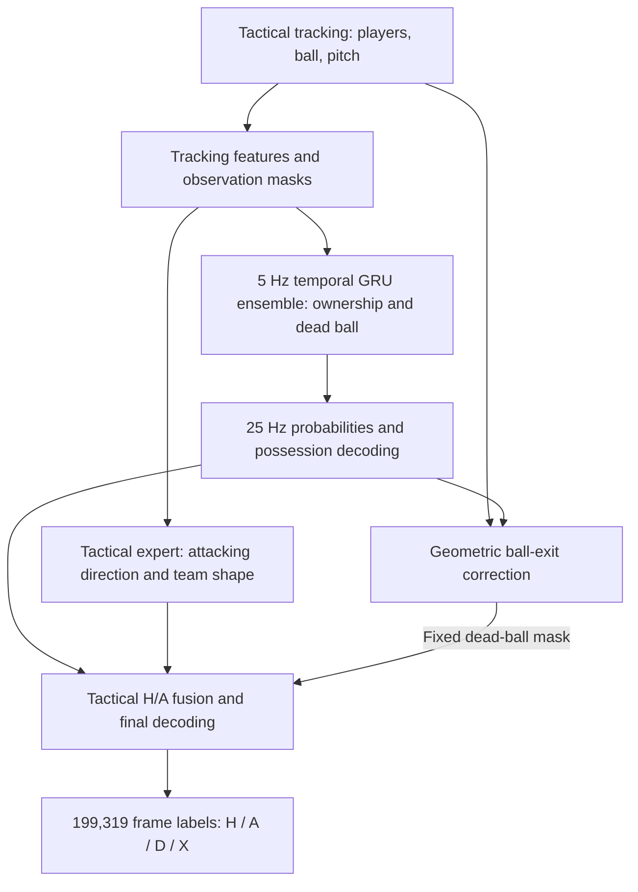
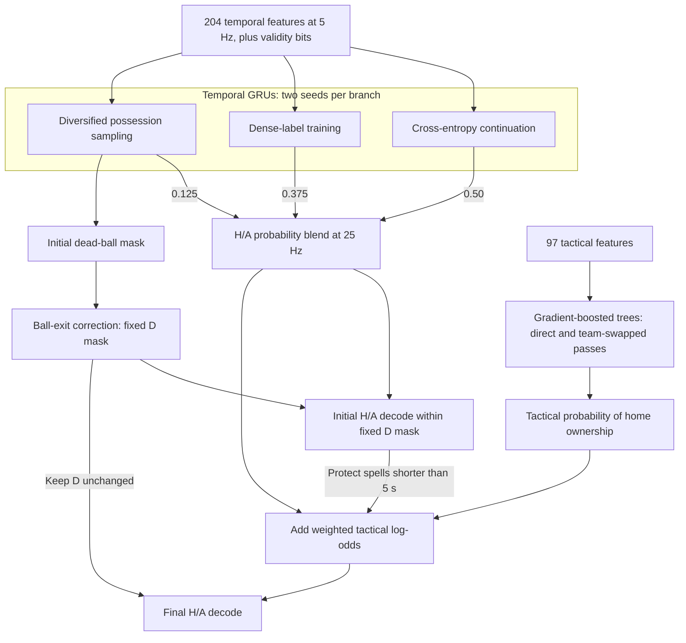
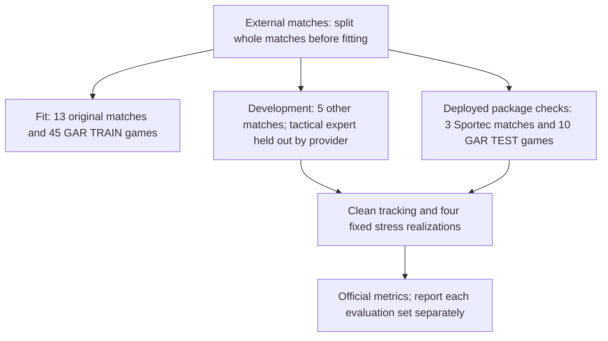

# Tracking-based football possession — Douki Douki

More Than A Hack 2027 · 16 November 2026



Temporal and tactical models combine with a ball-exit rule to produce labels.
This offline system uses past and future context. H/A denote home/away possession, D dead ball, and X frames
outside the tracking-defined halves.

## Data

Challenge-match inputs are `BAR-ATH_tactical_atd.xml` and `.txt`:
pitch geometry, team assignments, players and ball. Tactical video was inspected
to understand the feed, without creating labels or corrections. Broadcast
video/tracking and homographies were unused; Smart Tagging was audited and
dropped because its phases are not possession labels. No manual annotations,
human-produced events or private ground truth from this match enter the system.

All learning uses other matches:

| Dataset and source | Training amount | Label producer and construction |
| --- | --- | --- |
| [Sportec Open DFL, v1](https://doi.org/10.6084/m9.figshare.28196177.v1), CC BY 4.0 | 3 matches: J03WMX/J03WN1/J03WOH | Sportec Solutions/DFL `BallStatus` and `BallPossession` channels. |
| [Metrica Sports sample data](https://github.com/metrica-sports/sample-data) | Games 1–2 | Fixed H/A/D conversion of Metrica's human-annotated events. |
| [SkillCorner open data](https://github.com/SkillCorner/opendata), MIT, revision `4340d27` | 8 A-League matches | Provider `possession.group` for H/A and `game_interruption` for D; 1 s unknown margins. |
| [SoccerNet-GAR tracking-full](https://huggingface.co/datasets/OpenSportsLab/SoccerNet-GAR), revision `32c8402`, gated access | 45 TRAIN games | Algorithmic dense H/A/D silver labels from dataset touch/event columns; not human frame-level possession annotations. |

The temporal ensemble uses all 13 original matches and 45 GAR TRAIN games.
The tactical expert uses only the 13 original matches. Unknown targets and
match, half and segment breaks are preserved. Organizer public labels are used
only for a post-selection diagnostic, never training, tuning or selection.

## Features

**Align, clean and sample the tracking.** Each tactical ATD row maps to a video
frame; normalized coordinates are scaled by the pitch dimensions into metres.
Team membership comes from track-slot metadata. Computation resets at match,
half and timestamp breaks, so derivatives and rolling windows cannot bridge
unrelated periods. Internal ball gaps of at most 0.5 s are linearly interpolated;
longer gaps stay missing, and original observation flags are retained. Speeds
come from position differences multiplied by frame rate; implausible player
jumps are excluded from motion summaries. We compute features on the native
frame timeline and sample 5 Hz sequences for temporal modeling.

**Temporal inputs: 137 team/ball features plus 67 player-only features.**
The following families turn coordinates into evidence about control and stoppages:

| Feature family | How it is constructed and what it captures |
| --- | --- |
| Proximity and pressure | For each team, sort player-to-ball distances; keep the nearest three, counts within 2/5/10 m, and visible-player counts. Subtract home distance from away distance to measure the home team's proximity advantage. |
| Contact history | At 1/2/3 m proximity thresholds, record the nearest team's last and next close approach and the elapsed time to each. These are geometric contact proxies that preserve evidence through passes and loose-ball intervals. |
| Ball motion and boundaries | Differentiate ball positions to obtain speed, acceleration and turning; measure distance to the nearest pitch edge and velocity directed out of that edge. This describes kicks, deflections and exits. |
| Player–ball motion | For the nearest two players of each team, compute relative speed, closing speed and motion alignment. Combine proximity with shared motion into continuous control evidence; proximity with ball acceleration gives a contact-impulse proxy. |
| Missingness and short context | Keep raw observation/availability flags and time since/until an observed ball position. Centered rolling means summarize distances, nearest-team votes, speeds and visibility over short intervals. Future observations are allowed because inference is offline. |
| Player-only stoppage evidence | Aggregate speed mean, spread and quantiles; fractions moving slowly/quickly; motion coherence; squad spread; touchline occupancy; and team-centroid separation. Add centered summaries, typically at ±0.3/1/3 s. This 67-feature block uses no ball data. |

For example, a home player near the ball and moving with it provides stronger
control evidence than proximity alone. A mostly stationary squad with stable
team separation supplies dead-ball evidence even when the ball disappears.
Team aggregates and nearest-player ranks limit dependence on stable player IDs.

GRU preprocessing subtracts training-set feature medians, divides by training-set
standard deviations and clips standardized values to ±10. Missing values become
zero with a separate validity bit, producing 408 inputs from 204 raw features.
The dead-ball path receives only the player-only values and their validity bits.
All normalization statistics are fitted on training inputs and reused unchanged.

**Tactical inputs: 97 direction-aware features.** We infer each team's attacking
direction from the ordering of the teams' mean longitudinal positions over a
half. Coordinates are centered on the pitch and the longitudinal axis is oriented
to express progress in the team's attacking direction. For each frame we derive:

- **Ball progress:** oriented position and velocity, plus the difference between
  mean future and past ball positions over 2 s and 5 s horizons.
- **Ball relative to team shape:** distance along the pitch from ball to team
  centroid, second-deepest visible player (a defensive-line proxy) and most
  advanced player; fraction of visible players ahead of the ball; player counts
  within 10/20 m and mean player-to-ball distance.
- **Collective movement:** centroid and defensive-line forward speed, longitudinal
  and lateral spread, separation between team centroids, and centered ±1/3 s
  summaries. Counts and missing values describe partial visibility.

This gives the tactical expert field position and team structure beyond local
ball-contact evidence. Its boosted trees handle missing feature values directly.

## Modeling

The model has two complementary sources of ownership evidence: temporal tracking
context and team-level tactical structure. The diagram shows their outputs and
how the postprocessing below combines them.



### Temporal backbone and training objective

A gated recurrent unit (GRU) is a neural network that carries information along a
sequence. Bidirectional GRUs read both forward and backward, allowing observations
on either side of a ball gap to inform ownership. Each input window contains a
10 s prediction core plus 5 s context on either side; only the core is emitted.
The H/A network has hidden width 96. A separate player-only dead-ball network
uses width 24, avoiding provider-specific ball-visibility shortcuts at stoppages.

The ownership output is conditional: the probability of home versus away
possession **given that play is live**. Dead-ball probability is estimated
separately. Dense supervision supplies a target at every known training frame,
including algorithmically generated GAR silver labels; unknown targets are
excluded. Frame-level cross-entropy penalizes assigning low probability to the
correct team: a home-owned frame with predicted home probability 0.9 incurs
`-log(0.9)`. Possession-based weighting limits long runs' dominance, while a
transition term supervises ownership changes between neighboring frames. These
terms connect frame accuracy with the whole-possession ranking metric.

### Loss functions and target masks

Let $q_t=(q_{t,H},q_{t,A})$ be the conditional ownership softmax and
$d_t=P(D\mid x_t)$ the player-only dead-ball sigmoid. Their frame probabilities are

$$
P_t(H)=(1-d_t)q_{t,H},\qquad
P_t(A)=(1-d_t)q_{t,A},\qquad P_t(D)=d_t.
$$

The following is the dense-training objective used by the temporal branches;
the continuation retains its H/A terms while freezing D. These differentiable
losses encourage possession recovery, but **do not directly optimize the
official, discrete spell F1**. Spell F1 is used for external evaluation and selection.

**Duration-weighted ownership loss.** For a sampled window $w$, let $K_w$
contain its known H/A targets in the 10 s core. The loss is

$$
L_{HA}(w)=\frac{1}{|K_w|}\sum_{t\in K_w}s_t[-\log q_{t,y_t}].
$$

Only complete H/A spells receive duration weights. For duration $\ell$ seconds,
computed from native-rate labels before downsampling, the raw factor is
$r(\ell)=\mathrm{clip}(\sqrt{5/\ell},0.5,2)$. Factors are normalized to
mean one across eligible sampled rows within each training record. Spells
touching a record/time-block edge or an unknown target are censored and keep
$s_t=1$. The normalization can move final weights beyond the raw caps.
This increases short spells' contribution without treating incomplete runs as
known short possessions. D and unknown rows contribute no H/A loss; the
denominator counts known live rows, not the sum of duration weights.

**Ownership-transition loss.** For adjacent sampled frames with known live
targets, define $z_t=\mathbf{1}[y_t\ne y_{t+1}]$ and

$$
c_t=q_{t,H}q_{t+1,A}+q_{t,A}q_{t+1,H},\qquad
\mathrm{BCE}(c,z)=-z\log c-(1-z)\log(1-c).
$$

Within each data group (original providers or GAR), $L_{tr}$ is half the mean
BCE over stable pairs plus half the mean over changed pairs. An absent stable/change group
contributes zero rather than doubling the other group's weight. A pair is
eligible only if the full native interval between its endpoints is known and
stays within one time block; both sampled endpoints must be H/A. The final
core frame may pair with the first right-context frame, preserving chunk-seam
supervision. Probabilities are clipped to $[10^{-6},1-10^{-6}]$ for BCE.
This is a balanced surrogate built from endpoint marginals, not a learned
transition head or a calibrated joint transition probability.

**Dead/live loss and total objective.** For known H/A/D core targets $J_w$,
the independently parameterized player-only path uses

$$
L_D(w)=\frac{1}{|J_w|}\sum_{t\in J_w}
\mathrm{BCE}(d_t,\mathbf{1}[y_t=D]).
$$

With half of each batch from each data group, the dense-training loss is

$$
L=\sum_{g\in\{\mathrm{original},\mathrm{GAR}\}}\frac12
\left(\overline{L}_{HA,g}+0.05L_{tr,g}+\lambda_D\overline{L}_{D,g}\right).
$$

Bars denote averages of per-window losses within that group. Dense D training
uses $\lambda_D=1$; H/A continuation omits the D term and preserves its
checkpoint. The continuation's code name `ce_control` still includes duration
weights and the transition term; it adds no boundary-margin loss. Unknown
targets and padded core positions have zero supervised weight. The separate
short-possession sampler described below changes which windows are drawn, in
addition to the duration weighting inside each window.

Implementation: [dense trainer](../experiments/sn_dense_train.py),
[spell weights and transition masks](../experiments/objective_losses.py), and
[H/A continuation](../experiments/v2_iterative_train.py).

### The three temporal branches

All three branches share this temporal representation; they differ in training
history or sampling. Their H/A probabilities are blended as shown in the diagram.

1. **Dense-label branch — weight 0.375.** Train on known frame-level H/A/D targets
   from the 13 original matches and 45 GAR games, using frame, possession and
   transition supervision. Both ownership and the player-only D path are learned.
   This provides broad supervision across ordinary play and stoppages.
2. **Diversified-possession branch — weight 0.125.** Use the same dense targets,
   but deliberately spread training exposure across distinct short possessions.
   On original-provider data, 25% of eligible window draws are replaced by windows
   overlapping complete possessions of at most 3 s, cycling through a shuffled
   bag before reuse. GAR short-spell sampling additionally requires corroborating
   touch/geometry evidence. Labels are unchanged. This gives brief possessions
   more varied exposure than repeated random windows; this branch also supplies
   the initial dead-ball mask.
3. **Cross-entropy continuation — weight 0.5.** Start from the trained diversified
   ownership checkpoint and continue updating its H/A weights, rather than
   initializing a new network. The principal loss remains cross-entropy on known
   live frames, with the existing possession weights and transition term retained.
   The D network and normalization are frozen. Train for 512 updates at learning
   rate `3e-4`, followed by 512 at `1e-4`, cycling through four fixed tracking views.
   This adapts team attribution to feed defects without changing the learned
   stoppage detector. “Continuation” refers to this additional training stage.

Training batches have 32 windows, half from original providers and half from GAR,
so the larger GAR collection cannot dominate. Each branch uses seeds 2026/2027.
At 25 Hz there are five possible 5 Hz sampling offsets; each offset's predictions
are interpolated to the full timeline, then averaged across seeds and offsets.
This reduces sensitivity to initialization and which frames enter a sampled
sequence. Ensemble weights are selected on external development data.

### Tactical expert and combination

HistGradientBoosting is an ensemble of decision trees fitted sequentially, with
later trees correcting remaining prediction errors. It captures nonlinear
relationships in the 97 tactical features and outputs home-ownership probability
on live frames. It adds attacking direction and team shape to the temporal
models' local tracking evidence.

The classifier trains on 5 Hz live frames from the 13 original matches, with
clean and one synthetic `feed_like_v2` view, weighted equally by provider, match
and view. Team-swapped training examples exchange H/A identities and targets.
At inference, direct and swapped probabilities are mapped back to the same team
identity and averaged. This reduces dependence on home/away naming. The expert
supplies additional H/A evidence; postprocessing combines it with the temporal
ensemble while preserving the corrected dead-ball mask.

Its fitting objective is weighted binary log loss on known live frames:
$L_{tac}=\sum_i a_i\mathrm{BCE}(h_i,\mathbf{1}[y_i=H])/\sum_i a_i$.
Each provider has equal total weight, divided equally among its matches, views
and direct/swapped rows. The estimator uses 300 boosting iterations, learning
rate 0.05, at most 31 leaves per tree, minimum 200 samples per leaf and L2
regularization 1; early stopping is disabled. It has no D or transition loss.
See the [tactical trainer](../experiments/tactical_ha_train.py).

Released checkpoints freeze the exact models used for the submitted file.

## Postprocessing

Weights, decoder costs and timing windows were selected on external development
data and frozen before final package checks. The order matters: first establish
the dead-ball mask, then decode ownership with that mask fixed.

### 1. Reconstruct and pool native-frame probabilities

Each temporal branch predicts H/A/D at all five 5 Hz sampling offsets of the
25 Hz input. Linearly interpolate each probability channel within its continuous
time block, holding the nearest sampled value at the block edges. Average the
two seeds within each offset, then average offsets. No interpolation or decoder
state crosses a half or timestamp discontinuity. Convert each pooled branch to
conditional H/A by dividing its H/A probabilities by their sum, then form

$$
q_t^{mix}=0.50q_t^{CE}+0.375q_t^{dense}+0.125q_t^{diverse}.
$$

This is an arithmetic probability blend, not a vote among decoded labels.
The implementation names these roles `ce`, `calibrated` and `adopted`, respectively.

### 2. Decode the initial dead-ball mask

Use the diversified branch's pooled H/A/D probabilities alone for this step.
The frozen `f062` calibration softens its dead-ball probability to
$\tilde d_t=\sigma(\mathrm{logit}(d_t)/4)$, with D clipped to
$[10^{-7},1-10^{-7}]$ before taking the logit. H/A temperature is 1.
Recombine $((1-\tilde d_t)q_{t,H},(1-\tilde d_t)q_{t,A},\tilde d_t)$
and run three-state Viterbi decoding independently in each continuous block.

For frame probabilities $p_t$, the decoder finds

$$
\hat y=\arg\max_y\left[
\sum_t\log\max(p_t(y_t),10^{-7})-
\sum_{t>1}C(y_{t-1},y_t)\right].
$$

Staying in the same state costs zero. H↔A and live↔D switches each have
configured cost 3, scaled by $fps/10$: the actual penalty is **7.5 at 25 Hz**.
There is no hard minimum spell duration. Dynamic programming accumulates
evidence across the block and backtracks the best path; it is not framewise
argmax or a moving-majority filter. Only its D mask is retained at this stage.

### 3. Snap dead-ball starts to observed pitch exits

The frozen `snap_m0.0` rule uses finite, observed ball coordinates and the pitch
rectangle $[0,L]\times[0,W]$. Points on the boundary count as inside; any
strictly outside point counts as outside. Missing coordinates count as neither.
For each block, perform these edits in order:

1. **Delay an early D start.** For a D run $[a,b)$, search
   $[a,\min(b,a+5\,fps))$ for the first outside observation. If an inside
   observation occurs between the original start and that exit, make the
   intervening frames live, so D starts at the observed exit.
2. **Advance a late D start.** Recompute D runs after the delay step. Search up
   to 3 s before each start, bounded by the current time block. After the last
   inside observation in that interval (or its beginning if none exists), find
   the first outside observation. Extend D back to it only if the intervening
   frames contain no existing D segment.

Runs starting at the block boundary are skipped. The rule adjusts existing D
starts, leaves their ends unchanged and does not create an isolated D run merely
because an outside point exists. It uses neither ball speed nor frozen-ball
coordinates as a stoppage test. For example, a predicted D start at 100 s with
an inside observation at 100.2 s and the first outside observation at 101 s
moves to 101 s, provided that exit lies within the same D run and search window.
Missing exits leave the relevant boundary unchanged.

### 4. Decode H/A, add tactical evidence, then decode again

With corrected D fixed, run two-state Viterbi on $q^{mix}$ separately inside
each maximal live span, using the same H/A switch penalty. These initial labels
determine a gate $g_t$: zero inside an H/A spell strictly shorter than 5 s,
one otherwise. Spell durations are measured on the native frame timeline and
reset at time-block boundaries. A spell of exactly 5 s receives tactical evidence.

The tactical expert runs directly and with team identities swapped. Mapping
the swapped prediction back gives
$h_t=\tfrac12(h_t^{direct}+1-h_t^{swapped})$. Fuse it with the temporal blend:

$$
q'_{t,H}=\sigma\left(\mathrm{logit}(q^{mix}_{t,H})
+0.25g_t\mathrm{logit}(h_t)\right),\qquad q'_{t,A}=1-q'_{t,H}.
$$

Both logit inputs are clipped to $[10^{-6},1-10^{-6}]$. Decode $q'$ again
inside the same live spans. The short-spell gate suppresses added evidence;
it does **not** lock those labels, so global decoding may still move their
boundaries. The corrected D mask is asserted unchanged. There is no additional
median filter, minimum-duration pruning or manual correction after this pass.

### 5. Apply the output mask and serialize

Keep H/A/D inside the tracking-defined halves and overwrite frames with
nonpositive input period as X. A missing ball alone never triggers X. Write
199,319 consecutive `frame,label` rows, validate the submission format and check
the frozen CSV hash. Loose-ball ownership is learned from labels that retain
the last controlling team until controlled opponent contact; the decoder does
not detect touch events or explicitly enforce that convention at inference.

Implementation: [native probability pooling](../experiments/spell_frontier_baseline.py),
[calibration](../experiments/feed_spell_push.py),
[Viterbi recurrence and cost scaling](../experiments/decoder_search.py),
[ball-exit edits](../experiments/ball_exit_dmask_v1.py),
[fixed-D ownership decoding](../experiments/v2_spell_balanced_eval.py), and
[tactical fusion](../experiments/tactical_ha_runtime.py).

## Eval

Whole matches are separated for fitting and evaluation. Development uses
Sportec J03WOY, Metrica Game 3 and SkillCorner 1996435/1996436/2006229.
The tactical expert is also held out by provider; upstream components do not
constitute a fully nested provider holdout. We average matches within each
provider, then providers equally. Each match is evaluated on clean tracking and
four fixed `feed_like_v2` stress realizations. This simulator uses label-free
challenge-feed statistics to calibrate ball gaps, player dropout, tracking noise
and identity switches, with missingness concentrated around stoppages.

The exact deployed pooled package is checked on three additional Sportec
matches (J03WPY/J03WQQ/J03WR9) and ten GAR TEST games. Neither set enters
fitting. Corruption scores average four realizations within each game, then
games equally. Nine selected-on GAR VALID games remain separate from TEST.



The official ranking metric, spell F1, matches H/A possessions one-to-one by
temporal intersection over union (IoU), averaging F1 at thresholds 0.3, 0.4,
0.5, 0.6 and 0.7. Macro F1 averages frame-level F1 across H/A/D. Final results:

| Evaluation set | Clean spell F1 | Feed-like v2 spell F1 |
| --- | ---: | ---: |
| Five exposed development matches | 0.681742 | 0.603079 |
| Three additional Sportec matches | 0.744783 | 0.662575 |
| GAR TEST, ten games | 0.716648 | 0.715728 |

The organizer diagnostic covers 7,500
frames and 17 possessions: spell F1 **0.623529**, macro F1 **0.870218**,
D-F1 **0.889372**. The spell bootstrap 5–95% interval is [0.458824, 0.776471].
Full-match organizer performance is unknown. Sources:
[tactical evaluation](https://github.com/jekkiechan/more-than-a-hack-2027/blob/submission-2026-v1/experiments/TACTICAL_HA_V1.md)
and [public diagnostic](https://github.com/jekkiechan/more-than-a-hack-2027/blob/submission-2026-v1/experiments/TACTICAL_PUBLIC_V1.md).

Development selection included about 56 tactical fusion variants.
The clean short-possession recall guard was not satisfied;
adoption prioritized overall spell F1. GAR has silver labels, discontinuous
segments and repeated TEST exposure. Sportec is also a training provider;
two extra matches had prior evaluation exposure. V2 corruption is
model-conditioned and uses development labels in its construction. The reused
public window is small. These protocols cannot be pooled or treated as
independent continuous-match gold confirmation.

Long ball gaps can preserve a wrong owner, smoothing can merge brief possessions,
and unseen exits can defeat geometric correction. Further work needs independent,
continuously annotated matches and improved automatic tracking.

## How to reproduce

The frozen package is
`joint_gru_sn_dense_spell_frontier_ball_exit_tactical_ensemble_v1`.
[Public source and weights](https://github.com/jekkiechan/more-than-a-hack-2027/releases/tag/submission-2026-v1)
are pinned by `submission/model_manifest.json` and `submission/weights.json`.
On Linux with Python 3.12:

```sh
git clone --branch submission-2026-v1 https://github.com/jekkiechan/more-than-a-hack-2027.git
cd more-than-a-hack-2027
python3.12 -m venv .venv
. .venv/bin/activate
python -m pip install -r submission/requirements.txt
python -m pip install torch==2.8.0 --index-url https://download.pytorch.org/whl/cpu
```

Place the organizer's tactical ATD `.xml` and `.txt` files in `data/tactical/`, then run:

```sh
bash submission/make_submission.sh 'Douki Douki'
```

The wrapper verifies downloaded weights, prepares tracking without reference
labels, predicts with one CPU thread, validates format and checks the hash.
Clean-environment reproduction is verified. Output:
`data/submission/Douki Douki.csv`, 199,319 rows and 281 predicted possessions;
existing CSVs are not overwritten. Expected SHA-256:

```text
8e26f823a3e933f1feca2a64dfe6d7f728a4741548c8c7cd95d51746b6a355b9
```
