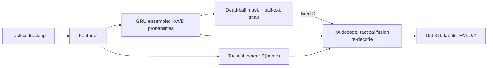

# Tracking-based football possession — Douki Douki

More Than A Hack 2027 · 16 November 2026

## 1. Overview

**Task.** We label every 25 Hz frame of the challenge match (BAR–ATH) as home
possession (H), away possession (A), dead ball (D) or outside the halves (X). The
only input is the organizer's tactical tracking feed (the "ATD" files): player
and ball positions. The system runs offline, so each frame can use past and
future context. A *spell* is one possession: a maximal run of H or A frames.

**System.** The pipeline has five components:

1. **Tracking features.** 204 features per frame describe who is near the ball,
   which team approached it last and next, how the ball and squads move, and
   which data are missing. 97 further features describe field position and team
   shape relative to each team's attacking direction.
2. **Temporal GRU ensemble.** Bidirectional recurrent networks (GRUs) read 20 s
   windows at 5 Hz and output H/A/D probabilities. Each model pairs an ownership
   network (which team has the ball during live play) with a player-only
   dead-ball network. Three differently trained models are blended.
3. **Tactical expert.** Gradient-boosted trees estimate the probability of home
   ownership from field position and team shape.
4. **Dead-ball mask.** A Viterbi decoder finds the most likely label sequence
   when every label switch carries a fixed cost, which turns noisy probabilities
   into stable runs. A geometric rule then moves each dead-ball start to the
   ball's observed exit from the pitch.
5. **Ownership decoding.** Inside live play, a second Viterbi pass decodes H/A,
   adds the tactical expert's evidence to spells of at least 5 s, and decodes
   again.



**Training data.** 13 matches from Sportec, Metrica and SkillCorner with
provider-produced labels, plus 45 SoccerNet-GAR games with *silver* labels
generated by a fixed rule from event data. No data from the challenge match is used for training, tuning or
selection, and nothing is annotated by hand.

**Results.** The official ranking metric, spell F1, matches predicted spells
one-to-one with true spells by temporal overlap (Section 6). *Feed-like
corruption* is our simulation of the challenge feed's defects: ball gaps, player
dropout, noise and identity switches. All sets below are separate from training.

| Evaluation set | Clean tracking | Feed-like corruption |
| --- | ---: | ---: |
| Five development matches | 0.682 | 0.603 |
| Three additional Sportec matches | 0.745 | 0.663 |
| GAR TEST, ten games | 0.717 | 0.716 |

On the organizer's public 5-minute window, used only as a pipeline check, the
submission scores 0.624. The organizer's published floor, `baseline_smooth50`
(nearest player to the ball with a majority-vote window), scores 0.326.

## 2. Design rationale

- **Temporal context.** Nearest-player smoothing and per-frame boosted models
  plateaued on development data. The first bidirectional GRU raised clean
  development spell F1 from 0.534 to 0.627
  ([screen](../experiments/LIVE_GAP_HAD_GRU.md)).
- **Whole possessions.** Spell F1 scores complete possessions, so each stage
  favours stable spells: duration-weighted and transition losses in training,
  and Viterbi decoding with switch costs at inference.
- **Team attribution.** In an early validation audit, 98.6% of wrong frames were
  H/A confusion ([audit](../experiments/HEADROOM.md)). Most model capacity
  therefore goes to ownership: three GRU branches plus the tactical expert.
- **Player-only dead ball.** External ball channels carry provider-specific
  dead-ball shortcuts; Sportec, for example, freezes the ball during stoppages.
  The dead-ball network therefore uses player motion only; ball positions only
  time stoppage starts at observed pitch exits.
- **Feed robustness.** The challenge feed is automatic and often loses the ball,
  so features carry missingness flags and models are trained and selected on
  feed-like corruption as well as clean tracking.

## 3. Assets and training data

| Challenge asset | Use |
| --- | --- |
| Tactical ATD (`.xml`, `.txt`) | The only model input: pitch geometry, team assignments, players and ball. |
| Tactical video | Inspected to understand the feed; produced no labels or corrections. |
| Broadcast video/tracking, homographies | Unused. |
| Smart Tagging | Audited and dropped: its phases do not match the possession definition. |

All labelled data comes from other matches:

| Dataset | Amount | Labels: producer and construction |
| --- | --- | --- |
| [Sportec Open DFL v1](https://doi.org/10.6084/m9.figshare.28196177.v1), CC BY 4.0 | 3 matches | Sportec Solutions/DFL `BallStatus` and `BallPossession` channels. |
| [Metrica sample data](https://github.com/metrica-sports/sample-data) | 2 games | Fixed H/A/D conversion of Metrica's human-annotated events. |
| [SkillCorner open data](https://github.com/SkillCorner/opendata), MIT, `4340d27` | 8 matches | Provider `possession.group` (H/A) and `game_interruption` (D), with 1 s unknown margins. |
| [SoccerNet-GAR tracking-full](https://huggingface.co/datasets/OpenSportsLab/SoccerNet-GAR), `32c8402`, gated | 45 TRAIN games | Dense H/A/D silver labels from a fixed rule over the dataset's touch and event columns. |

The GRUs train on all 58 matches and games; the tactical expert trains on the
13 provider-labelled matches. Organizer public labels serve only as a post-selection check.

## 4. Method

**Features.** Ball gaps up to 0.5 s are interpolated; longer gaps stay missing
with observation flags. The 204 temporal features fall into six
families: proximity and pressure, contact history, ball motion and boundaries,
player–ball motion, missingness, and player-only stoppage evidence (67
features). The 97 tactical features describe ball progress, the ball's position
relative to each team's shape, and collective movement. Appendix A lists them.

**Temporal GRU ensemble.** Each window has a 10 s prediction core and 5 s of
context on each side. The ownership network (hidden width 96) predicts home
versus away given live play; the dead-ball network (width 24) sees only the
player-only features. Training combines cross-entropy, duration weights that
raise short possessions' influence, and a transition term (Appendix B). Three
branches share this architecture and differ in training (Appendix C):

| Branch | Training | Blend weight |
| --- | --- | ---: |
| Dense-label | All dense H/A/D targets | 0.375 |
| Diversified-possession | Oversamples windows around short possessions; supplies the dead-ball mask | 0.125 |
| Cross-entropy continuation | Further H/A training of the diversified branch on four fixed tracking views, D frozen | 0.5 |

Each branch has two seeds, and predictions are averaged over seeds and the five
possible 5 Hz sampling offsets of the 25 Hz timeline.

**Tactical expert.** A HistGradientBoosting classifier on the 97 tactical
features predicts home ownership on live frames, averaged over the original and
team-swapped inputs.

**Decoding.** Four steps produce the labels (Appendix D):

1. **Pool.** Interpolate each branch to 25 Hz and blend the three branches' H/A
   probabilities with the weights above.
2. **Dead-ball mask.** Run a three-state Viterbi decoder on the diversified
   branch. Each switch costs 7.5 at 25 Hz, which suppresses one-frame flickers.
3. **Ball-exit snap.** Move each dead-ball start to the first observed ball
   position outside the pitch: an early start moves later by up to 5 s, a late
   start moves earlier by up to 3 s.
4. **Ownership.** With D fixed, decode H/A in each live span. Add 0.25 × the
   tactical log-odds on spells of at least 5 s (threshold selected on
   development data), then decode again.

## 5. Possession rules

- **Three states.** H and A form spells; D marks stoppages.
- **Loose and contested balls.** Possession stays with the last controlling team
  until an opponent controls the ball. In the GAR label rule, an opponent touch
  tagged as a challenge, rebound or clearance keeps the current owner. The model
  learns this from the labels and applies it from geometry alone.
- **Restarts.** In GAR labels the ball is dead from an `OUT` event until the next
  touch, and the next toucher becomes the owner. At inference, dead-ball starts
  snap to observed pitch exits.
- **Missing ball.** Bidirectional context and the decoder's switch cost carry
  the current owner through ball gaps until the players' geometry shows a change.
- **X.** Written only on frames outside the two halves, as marked by the
  tracking feed's period field. A missing ball never triggers X. Every frame in play receives H, A or D.

## 6. Evaluation

Whole matches are split before fitting. **Development** uses five matches
(Sportec J03WOY, Metrica Game 3, SkillCorner 1996435/1996436/2006229), all
distinct from the 13 training matches, averaged within provider and then across
providers. **Deployed-package checks** use three further Sportec matches and ten
GAR TEST games, also unused in fitting. Each match is scored on clean tracking
and on four fixed feed-like corruptions (`feed_like_v2`).

Spell F1 matches predicted and true H/A possessions one-to-one by temporal IoU
and averages F1 over thresholds 0.3–0.7. Macro F1 averages frame-level F1 over
H/A/D. On the public window (7,500 frames, 17 possessions) the submission scores
spell F1 0.624 (bootstrap 5–95%: 0.459–0.776), macro F1 0.870 and D-F1 0.889.
Full-match performance is unknown; Appendix E lists the limits of these
evaluation sets.

## 7. Limitations

- **Long ball gaps** can carry a wrong owner across the gap.
- **Brief possessions** can be merged by decoder smoothing. The model missed our
  clean short-possession recall guard; we adopted it for its higher overall
  spell F1.
- **Unobserved exits** leave dead-ball starts uncorrected, because the snap rule
  needs a ball position outside the pitch.
- **Domain shift.** All labels come from other providers or rule-generated
  silver labels, whose possession definitions differ from the challenge's. Synthetic corruption only approximates the challenge feed.

**With more time** we would annotate independent continuous matches for
confirmation and improve the automatic tracking itself.

## 8. Reproduction

Requires Linux x86-64, Python 3.12.14 and
[`uv`](https://docs.astral.sh/uv/getting-started/installation/) 0.12.23.
Put the organizer's tactical ATD `.xml` and `.txt` in `data/tactical/`, then:

```sh
git clone https://github.com/jekkiechan/more-than-a-hack-2027.git
cd more-than-a-hack-2027
uv sync --project submission --locked
uv run --project submission --locked bash submission/make_submission.sh 'Douki Douki'
```

The script downloads and verifies the
[released weights](https://github.com/jekkiechan/more-than-a-hack-2027/releases/tag/submission-2026-v1),
predicts on one CPU thread and writes `data/submission/Douki Douki.csv` (199,319
rows, 281 predicted possessions). Expected SHA-256:
`8e26f823a3e933f1feca2a64dfe6d7f728a4741548c8c7cd95d51746b6a355b9` (details in
Appendix F).

<div class="page-break"></div>

## Appendix A. Features

**Cleaning and sampling.**

- **Coordinates.** Each tactical ATD row maps to a video frame. Normalized
  coordinates are scaled by the pitch dimensions into metres. Team membership
  comes from track-slot metadata.
- **Breaks.** Computation resets at match, half and timestamp breaks, so
  derivatives and rolling windows never bridge unrelated periods.
- **Ball gaps.** Internal ball gaps of at most 0.5 s are linearly interpolated.
  Longer gaps stay missing, and original observation flags are retained.
- **Speeds.** Position differences multiplied by frame rate. Implausible player
  jumps are excluded from motion summaries.
- **Sampling.** Features are computed on the native frame timeline, then sampled
  as 5 Hz sequences for temporal modeling.

**Temporal inputs: 137 team/ball features plus 67 player-only features.**

| Feature family | Construction and purpose |
| --- | --- |
| Proximity and pressure | For each team, sort player-to-ball distances; keep the nearest three, counts within 2/5/10 m, and visible-player counts. Away minus home distance measures the home team's proximity advantage. |
| Contact history | At 1/2/3 m thresholds, record each team's last and next close approach and the elapsed time to each. These geometric contact proxies preserve evidence through passes and loose balls. |
| Ball motion and boundaries | Ball speed, acceleration and turning; distance to the nearest pitch edge and velocity towards it. These describe kicks, deflections and exits. |
| Player–ball motion | For the nearest two players of each team: relative speed, closing speed and motion alignment. Proximity combined with shared motion gives control evidence; proximity with ball acceleration gives a contact-impulse proxy. |
| Missingness and short context | Raw observation flags and time since/until an observed ball position. Centered rolling means of distances, nearest-team votes, speeds and visibility. Future observations are allowed because inference is offline. |
| Player-only stoppage evidence | Speed mean, spread and quantiles; fractions moving slowly or quickly; motion coherence; squad spread; touchline occupancy; team-centroid separation; centered summaries at ±0.3/1/3 s. Uses no ball data. |

A home player near the ball and moving with it gives stronger control evidence
than proximity alone. A mostly stationary squad with stable team separation
gives dead-ball evidence even when the ball disappears. Team aggregates and
nearest-player ranks limit dependence on stable player IDs.

**GRU preprocessing.** Subtract training-set medians, divide by training-set
standard deviations and clip to ±10. Missing values become zero with a separate
validity bit, giving 408 inputs from 204 features. The dead-ball path receives
only the player-only values and their validity bits. Normalization statistics
are fitted on training inputs and reused unchanged.

**Tactical inputs: 97 direction-aware features.** Each team's attacking
direction is inferred from the ordering of the teams' mean longitudinal
positions over a half. Coordinates are centered on the pitch and oriented in the
team's attacking direction. Three groups:

- **Ball progress:** oriented position and velocity, and mean future minus mean
  past ball position over 2 s and 5 s.
- **Ball relative to team shape:** longitudinal distance from the ball to the
  team centroid, the second-deepest visible player (a defensive-line proxy) and
  the most advanced player; fraction of visible players ahead of the ball;
  player counts within 10/20 m; mean player-to-ball distance.
- **Collective movement:** centroid and defensive-line forward speed,
  longitudinal and lateral spread, separation between team centroids, and
  centered ±1/3 s summaries. Counts and missing values describe partial
  visibility. The boosted trees handle missing values natively.

## Appendix B. Training losses

Let $q_t=(q_{t,H},q_{t,A})$ be the conditional ownership softmax and
$d_t=P(D\mid x_t)$ the player-only dead-ball sigmoid. Frame probabilities are

$$
P_t(H)=(1-d_t)q_{t,H},\qquad
P_t(A)=(1-d_t)q_{t,A},\qquad P_t(D)=d_t.
$$

The dense-training objective has three terms. Spell F1 is discrete, so it is
used for evaluation and selection, and these differentiable terms approximate it.

**Duration-weighted ownership loss.** For a sampled window $w$ with known H/A
core targets $K_w$:

$$
L_{HA}(w)=\frac{1}{|K_w|}\sum_{t\in K_w}s_t[-\log q_{t,y_t}].
$$

- Complete H/A spells of duration $\ell$ seconds, measured on native-rate labels,
  get raw factor $r(\ell)=\mathrm{clip}(\sqrt{5/\ell},0.5,2)$.
- Factors are normalized to mean one across eligible sampled rows within each
  training record; normalization can move final weights beyond the raw caps.
- Spells touching a record/time-block edge or an unknown target are censored and
  keep $s_t=1$, so incomplete runs are never treated as short possessions.
- D and unknown rows contribute no H/A loss. The denominator counts known live
  rows.

**Ownership-transition loss.** For adjacent sampled frames with known live
targets, let $z_t=\mathbf{1}[y_t\ne y_{t+1}]$ and

$$
c_t=q_{t,H}q_{t+1,A}+q_{t,A}q_{t+1,H},\qquad
\mathrm{BCE}(c,z)=-z\log c-(1-z)\log(1-c).
$$

- Within each data group (original providers or GAR), $L_{tr}$ is half the mean
  BCE over stable pairs plus half the mean over changed pairs. An absent group
  contributes zero.
- A pair is eligible when the full native interval between its endpoints is
  known and inside one time block, and both endpoints are H/A. The final core
  frame may pair with the first right-context frame.
- Probabilities are clipped to $[10^{-6},1-10^{-6}]$. The term is a balanced
  surrogate built from endpoint marginals.

**Dead/live loss and total objective.** For known H/A/D core targets $J_w$:

$$
L_D(w)=\frac{1}{|J_w|}\sum_{t\in J_w}\mathrm{BCE}(d_t,\mathbf{1}[y_t=D]),
$$

$$
L=\sum_{g\in\{\mathrm{original},\mathrm{GAR}\}}\frac12
\left(\overline{L}_{HA,g}+0.05L_{tr,g}+\lambda_D\overline{L}_{D,g}\right).
$$

Bars denote per-window averages within a group. Dense training uses
$\lambda_D=1$. The continuation (code name `ce_control`) drops the D term, keeps
duration weights and the transition term, and adds no boundary-margin loss.
Unknown targets and padded core positions have zero weight. Code:
[dense trainer](../experiments/sn_dense_train.py),
[losses](../experiments/objective_losses.py),
[continuation](../experiments/v2_iterative_train.py).

## Appendix C. Temporal branches and tactical expert

1. **Dense-label branch (0.375).** Trains ownership and the player-only D path on
   known H/A/D targets from the 13 original matches and 45 GAR games.
2. **Diversified-possession branch (0.125).** Same targets. On original-provider
   data, 25% of window draws are replaced by windows overlapping complete
   possessions of at most 3 s, cycling through a shuffled bag before reuse. GAR
   short-spell draws also require corroborating touch/geometry evidence. Labels
   are unchanged. This branch supplies the initial dead-ball mask.
3. **Cross-entropy continuation (0.5).** Starts from the diversified branch's
   ownership checkpoint and keeps training its H/A weights with D and
   normalization frozen: 512 updates at learning rate `3e-4`, then 512 at
   `1e-4`, cycling through four fixed tracking views. This adapts team
   attribution to feed defects and leaves the stoppage detector unchanged.

**Shared settings.** Batches of 32 windows, half from original providers and
half from GAR. Seeds 2026 and 2027. Ensemble weights were selected on external
development data.

**Tactical expert.** HistGradientBoosting fits decision trees sequentially, each
correcting the previous trees' errors. It trains on 5 Hz live frames from the 13
original matches, on clean and one `feed_like_v2` view, plus team-swapped copies.
The loss is weighted binary log loss
$L_{tac}=\sum_i a_i\mathrm{BCE}(h_i,\mathbf{1}[y_i=H])/\sum_i a_i$; each provider
has equal total weight, split equally across matches, views and direct/swapped
rows. Settings: 300 iterations, learning rate 0.05, at most 31 leaves, at least
200 samples per leaf, L2 regularization 1, no early stopping. Code:
[tactical trainer](../experiments/tactical_ha_train.py).

## Appendix D. Decoding details

All weights, costs and windows were selected on external development data and
frozen before the final package checks.

**D1. Pooling.** Each branch predicts at all five 5 Hz offsets. Each channel is
linearly interpolated within its continuous time block (nearest value at block
edges). Seeds are averaged within offset, then offsets are averaged. Each
branch is converted to conditional H/A, then blended arithmetically:

$$
q_t^{mix}=0.50q_t^{CE}+0.375q_t^{dense}+0.125q_t^{diverse}.
$$

Code names: `ce`, `calibrated`, `adopted`.

**D2. Dead-ball mask.** The frozen `f062` calibration softens the diversified
branch's dead-ball probability to $\tilde d_t=\sigma(\mathrm{logit}(d_t)/4)$
(D clipped to $[10^{-7},1-10^{-7}]$; H/A temperature 1). The decoder maximizes

$$
\hat y=\arg\max_y\left[
\sum_t\log\max(p_t(y_t),10^{-7})-\sum_{t>1}C(y_{t-1},y_t)\right]
$$

over $p_t=((1-\tilde d_t)q_{t,H},(1-\tilde d_t)q_{t,A},\tilde d_t)$, separately
in each continuous block. H↔A and live↔D switches have configured cost 3, scaled
by $fps/10$ to 7.5 at 25 Hz. There is no minimum spell duration. Only the D mask
is kept.

**D3. Ball-exit snap (`snap_m0.0`).** Uses finite observed ball coordinates and
the pitch rectangle $[0,L]\times[0,W]$; boundary points count as inside, missing
coordinates as neither. Per block, in order:

1. **Delay an early start.** For a D run $[a,b)$, find the first outside
   observation in $[a,\min(b,a+5\,fps))$. If an inside observation precedes it,
   relabel the intervening frames live.
2. **Advance a late start.** Search up to 3 s before each recomputed D start.
   After the last inside observation, find the first outside one and extend D
   back to it when no other D segment lies between.

Runs starting at a block boundary are skipped, D ends are unchanged, and no new
D run is created. Example: a D start at 100 s, an inside observation at 100.2 s
and the first outside observation at 101 s move the start to 101 s.

**D4. Ownership and fusion.** Two-state Viterbi on $q^{mix}$ runs in each live
span with the same switch cost. A gate $g_t$ equals 0 inside initial spells
shorter than 5 s and equals 1 elsewhere. With $h_t=\tfrac12(h_t^{direct}+1-h_t^{swapped})$:

$$
q'_{t,H}=\sigma\left(\mathrm{logit}(q^{mix}_{t,H})+0.25g_t\mathrm{logit}(h_t)\right).
$$

Inputs are clipped to $[10^{-6},1-10^{-6}]$, and $q'$ is decoded again. The gate
withholds tactical evidence from short spells; the decoder may still move their
boundaries. The D mask is asserted unchanged. No further filtering or manual
correction follows. Code: [pooling](../experiments/spell_frontier_baseline.py),
[calibration](../experiments/feed_spell_push.py),
[Viterbi](../experiments/decoder_search.py),
[ball exit](../experiments/ball_exit_dmask_v1.py),
[fixed-D decoding](../experiments/v2_spell_balanced_eval.py),
[fusion](../experiments/tactical_ha_runtime.py).

## Appendix E. Evaluation protocol

These sets cannot be pooled or treated as independent confirmation on
continuously annotated matches:

- The tactical expert is held out by provider during development; upstream components are held out by
  whole match, without a fully nested provider holdout.
- Corruption scores average four realizations within each match, then matches
  equally. Nine selected-on GAR VALID games stay separate from TEST.
- `feed_like_v2` is calibrated with label-free challenge-feed statistics, with
  missingness concentrated around stoppages. Its construction is
  model-conditioned and uses development labels.
- Development selection covered about 56 tactical fusion variants.
- GAR has silver labels, discontinuous segments and repeated TEST exposure.
  Sportec is also a training provider, and two of the extra Sportec matches had
  prior evaluation exposure. The public window is small and was reused.

Sources: [tactical evaluation](https://github.com/jekkiechan/more-than-a-hack-2027/blob/submission-2026-v1/experiments/TACTICAL_HA_V1.md),
[public diagnostic](https://github.com/jekkiechan/more-than-a-hack-2027/blob/submission-2026-v1/experiments/TACTICAL_PUBLIC_V1.md).

## Appendix F. Environment

The frozen package is
`joint_gru_sn_dense_spell_frontier_ball_exit_tactical_ensemble_v1`, pinned by
`submission/model_manifest.json` and `submission/weights.json`.
`submission/pyproject.toml` pins direct dependencies and the CPU-only PyTorch
index; `submission/uv.lock` pins transitive dependencies and hashes. `--locked`
rejects an outdated lockfile. The `submission-2026-v1` tag predates the
lockfile, so use a later checkout. Record `git rev-parse HEAD` alongside the
output hash. The script prepares tracking without reference labels, validates
the format, checks the hash and never overwrites an existing CSV. A
hash-checked pip fallback is in
[the submission README](README.md#environment-maintenance-and-pip-fallback).
